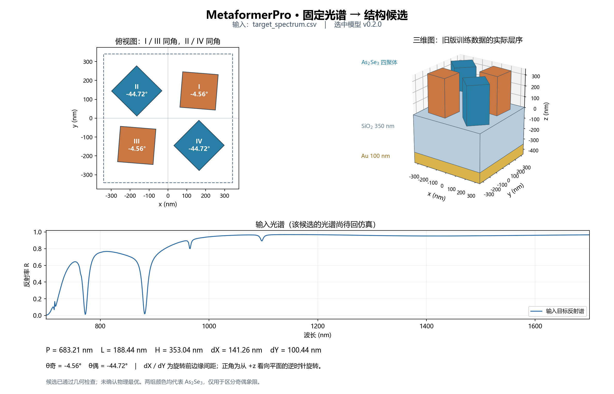
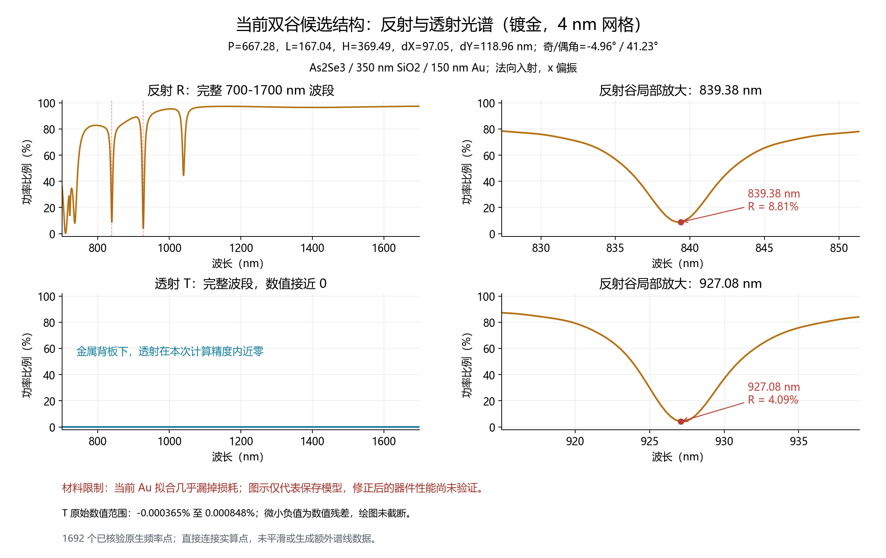

# MetaformerPro：As₂Se₃ 四聚体七参数逆向设计

补充的[光谱近邻诊断](results/spectral_information_audit/README.md)保存在 `codex/metaformerpro-information-audit`：仅用800条训练与100条既有验证，比较原谱/训练集标准化两种固定距离。现用网络dY验证MAE为13.79 nm，两种1NN为19.43/17.86 nm；相近光谱仍存在局部数个百分点差异，不能据平均RMSE断定同谱。该诊断不替换直接逆向模型，不新增训练或FDTD，可用 `python diagnose_spectral_neighbors.py` 复现。

## 当前：共振局部细分输入编码（2026-10-27）

独立工作树 `D:/projects/MetaformerPro_resonance/Metaformer_As2Se3`，分支 `codex/metaformerpro-resonance-tokenization`。保留原100个全谱token，再附加32个token；比较全域均匀附加与按输入谱可信谷取样，两组共用原Conv10和4层、96维、圆周头骨干，均为320,938参数。原模型文件继续保留。

取样规则在训练前固定：11点三阶SG副本定位，显著度0.01、最小间隔20个原网格点；最多两谷，各16个附加token，窗口跨度为半突出宽度的4倍，截在16–240个原网格间隔内。无谷回退全域均匀32token，单谷时第二块为全域均匀16token。定位不读取结构标签，实际输入仍为原反射率，不做局部深度归一化。绝对波长中心、覆盖跨度和附加类型标记采用固定编码，不增加可训练参数。连续插值不增加数据的实际分辨率。

PyCharm运行项 **22 MetaformerPro resonance train** 完成3种子对照，**23 MetaformerPro resonance spectrum to structure** 读取另行保留的共振实验候选并展示结构。解释器仍为 `D:/Anaconda3/envs/transformer_env/python.exe`。结果保存在独立的 [输入编码试验目录](results/topmetal_resonance/README.md)。`models/metaformerpro_resonance.pt` 是按验证规则冻结的输出；需查看结果中的 `selected` 与推理JSON里的 `model_config.sampling`，不能仅凭文件名认定共振方案已胜出。实验候选文件 `models/metaformerpro_resonance_candidate.pt` 不会覆盖现用模型，运行项17继续使用现用权重。

```powershell
python train_metaformerpro_refine.py all --config configs/metaformerpro_topmetal_resonance.json
python summarize_resonance_study.py
python predict_metaformerpro.py --checkpoint models/metaformerpro_resonance_candidate.pt --spectrum inputs/target_topmetal.csv --output results/topmetal_resonance/prediction_207.json --show
```

沿用同一1000条修正材料/层序数据及800/100/100划分，仅训练逆向模型，无新增FDTD。训练输入统计只由训练集拟合；阈值和窗口规则不根据验证或测试结果调整。测试仍为已查看过的既有集合，不是新盲测。现用100-token基线的三个已有运行重载核对后复用；两种132-token方案从相同种子随机初始化，训练预算与现用基线相同。

实测完成6次新训练，合计9.4分钟。原基线、均匀加密、共振局部细分的三种子平均镜像验证MSE为0.024448、0.024301、0.024347。共振组比基线降低0.41%，但比相同token数的均匀加密增加0.19%，两种新编码均未达到1%替换门槛。冻结选择仍为原4层seed42；共振实验seed42单独保留，未据测试结果再选方案。18项相关程序测试通过。

## 历史：增加编码器层数（2026-10-27）

工作树 `D:/projects/MetaformerPro_depth/Metaformer_As2Se3`，分支 `codex/metaformerpro-depth-study`。比较4层、8层、12层编码器，每个深度3个种子；宽度96、圆周头、0.02归一化下限、数据、优化器及训练预算相同，仅层数不同。4层的三个已有基线权重重载验证后复用，8/12层从随机初始化训练。

PyCharm运行项 **20 MetaformerPro depth train** 执行深度对照，**21 MetaformerPro depth spectrum to structure** 加载冻结选择并展示结构。解释器 `D:/Anaconda3/envs/transformer_env/python.exe`。本轮输出是 `models/metaformerpro_depth.pt` 和独立种子权重，旧输出文件保留。[结果与训练曲线](results/topmetal_depth/report.md)。

实测结果：4/8/12层三种子平均验证MSE为0.024448/0.024404/0.023774。12层通过验证门槛，固定输出seed44（919,210参数，实验版本0.3.1），但三种子平均测试MSE反而由0.025325升至0.026911。12层只作为实验候选保留；原4层 `models/metaformerpro_topmetal.pt` 和运行项17继续可用。运行项21专门查看12层候选，JSON同时记录实际层数、宽度和输出头。

```powershell
python train_metaformerpro_refine.py all --config configs/metaformerpro_topmetal_depth.json
python summarize_metaformerpro_depth.py
python predict_metaformerpro.py --checkpoint models/metaformerpro_depth.pt --spectrum inputs/target_topmetal.csv --output results/topmetal_depth/prediction_207.json --show
```

输入仍要求700–1700 nm等间距1000点、R在0–1。只优化逆向模型；本轮未生成新FDTD数据。验证选型后只比较基线和冻结选择的测试结果，既有100条测试集不视为新盲测。结构图中的光谱是输入目标，候选实际光谱仍待后续回验。

## 历史：继续优化新层序模型（2026-10-27）

工作树 `D:/projects/MetaformerPro_refine/Metaformer_As2Se3`，分支 `codex/metaformerpro-topmetal-refine`。在同一800/100/100划分上，对标准化下限、保留分块位置的读出、更宽编码器做三个种子的有限对照。[结果、收敛和逐参数误差](results/topmetal_refine/report.md)。新权重单独保存为 `models/metaformerpro_refined.pt`，此前的 `models/metaformerpro_topmetal.pt` 保留。

本轮九次新训练共15.1分钟。三个候选平均镜像验证MSE分别为0.024715、0.026661、0.025442，均未优于基线0.024448；冻结选择继续采用原0.2.0圆周头seed42。`metaformerpro_refined.pt` 与原部署权重逐字节相同，参数预测和结构示意图保持一致。新增的215万参数读出与127万参数编码器保留为实验选项，未作为性能升级部署。

PyCharm选择 **18 MetaformerPro refine train** 做训练对照，或 **19 MetaformerPro refined spectrum to structure** 直接推理。解释器仍是 `D:/Anaconda3/envs/transformer_env/python.exe`。输入格式与之前一致，替换 `inputs/target_topmetal.csv` 即可；候选结构的光谱仍须后续电磁回验。

```powershell
python train_metaformerpro_refine.py all
python summarize_topmetal_refine.py
python predict_metaformerpro.py --checkpoint models/metaformerpro_refined.pt --spectrum inputs/target_topmetal.csv --output results/topmetal_refine/prediction_207.json --show
```

基线三个已有运行随项目保存，检查点身份、归一化训练ID和验证预测均会核对。新候选只用训练谱拟合预处理，验证结果决定是否替换；要求综合验证MSE至少改善1%，且五尺寸MSE、dX MAE、dY MAE不超过预先设定的退步门槛。冻结选择后只测试基线和选中方案，已有测试集的重复比较不作为新盲测。

## 历史：新层序1000样本（2026-10-24汇总）

本分支 `codex/metaformerpro-topmetal-1000` 位于 `D:/projects/MetaformerPro_topmetal/Metaformer_As2Se3`。只使用新生成器2.2.0的1000条光谱，实际层序为**厚SiO₂ / Au 100 nm / As₂Se₃四聚体**，SiO₂延伸至下PML，采用修正的被动JC金材料。原始数据完整性、层序、材料身份、原生关断状态已核对；局部8 nm网格仍属于数值流程验证，未作为物理精度收敛证明。

两个现有输出头均重新随机初始化，每个训练三个种子，固定800/100/100划分。验证集决定输出头和部署种子，测试集只作冻结后的评价。[完整结果与图表](results/topmetal1000/report.md)。新权重为 `models/metaformerpro_topmetal.pt`，旧权重 `models/metaformerpro.pt` 继续保留，二者适用不同层序。

部署圆周头seed42（320,938参数）。三种子平均镜像等价测试MSE为0.025325，比同批Sigmoid头低3.4%；五尺寸MSE低6.3%。P/L/H/dX/dY的MAE约4.41/1.43/4.11/6.39/14.53 nm，奇/偶角MAE约12.48/12.93°；这里角误差采用联合镜像等价评价，原始标签周期误差在报告中同时保留。所选单模型的100条测试结构均通过几何检查。

在PyCharm使用 `D:/Anaconda3/envs/transformer_env/python.exe`，运行项 **16 MetaformerPro topmetal train** 训练，**17 MetaformerPro topmetal predict** 输入固定光谱并显示结构。命令行等价操作：

```powershell
python train_metaformerpro.py all --config configs/metaformerpro_topmetal1000.json
python predict_metaformerpro.py --checkpoint models/metaformerpro_topmetal.pt --spectrum inputs/target_topmetal.csv --output results/topmetal1000/prediction_207.json --show
```

替换 `inputs/target_topmetal.csv` 可输入自己的光谱：两列 `wavelength_nm,reflectance`，700–1700 nm等间距1000点，R为0–1。模型返回一个结构候选及几何检查；图中光谱为输入目标，尚未对候选运行新FDTD。图的层序读取权重元数据，厚SiO₂只画截示部分，不代表有限350 nm基板。

这批数据中691条在1000 nm以上存在突出度≥0.1的普通谷，但严格双主谷仅3条，且没有一条两主谷均在1000 nm以上。固定207号示例约770 nm的谷最显著，不代表最佳结构。阈值、逐谱结果与分割计数见 [光谱覆盖分析](results/topmetal1000/spectral_coverage.json)。

以下为保留的旧层序实验记录，旧指标和入口不代表当前新数据模型。

## 历史：MetaformerPro（2026-10-23，旧层序）

本轮独立工作树为 `D:/projects/MetaformerPro`，分支 `codex/metaformerpro`。模型代码 `metaformerpro.py`，训练 `train_metaformerpro.py`，推理 `predict_metaformerpro.py`。[本轮对照与结果](results/metaformerpro_v02/report.md)。昨日最优模型命名为 MetaformerPro 0.1，转换权重后预测保持一致；圆周输出、七参数查询池化及重叠分块作为0.2候选进行同一验证。

验证选中单独圆周角度头，导出为0.2：五尺寸测试MSE降低3.4%，原始标签周期MSE降低8.3%，镜像等价MSE略升1.3%。dX MAE从7.165降至6.659 nm；偶数角仍退步。320,938参数，部署seed44的100条测试预测全部通过几何检查；这不保证后续输入全部合法，推理仍返回检查结果。

```powershell
python train_metaformerpro.py all
python summarize_metaformerpro.py
python predict_metaformerpro.py --sample-id 207
```

PyCharm配置为 `13 MetaformerPro train v02` / `14 MetaformerPro predict`，解释器仍为 `D:/Anaconda3/envs/transformer_env/python.exe`。部署权重 `models/metaformerpro.pt`。进度在 `runs/metaformerpro_v02/status.json` 和 `study.log`，输出、缓存均放在D盘。

选型同时约束尺寸误差：五尺寸验证MSE最多增加2%，dX验证MAE最多增加5%，之后按三种子平均镜像等价MSE排序。保留全部试验与旧权重；同一固定测试集上的后续优化不视为新的盲测。

## 输入固定光谱并展示结构（旧层序）

在 PyCharm 打开本目录，使用 `D:/Anaconda3/envs/transformer_env/python.exe`，选择运行项 **15 MetaformerPro spectrum to structure** 后点击运行。它读取已训练并选中的 `models/metaformerpro.pt`，输出七个物理参数、几何检查结果、俯视图和三维示意图，随后在默认浏览器中打开图片。此入口只做推理，更新输入光谱后无需重新训练。

输入文件为 `inputs/target_spectrum.csv`，已放入此前固定的207号目标谱作为示例。替换它即可输入自己的光谱，格式为两列 `wavelength_nm,reflectance`：波长单位 nm，反射率使用0–1数值；当前权重要求700–1700 nm等间距1000点，含两个端点（步长为1000/999 nm）。不匹配的波长网格会报错，不静默插值。

```powershell
python predict_metaformerpro.py --spectrum inputs/target_spectrum.csv --output results/custom_spectrum/prediction.json --show
```

结果为 `results/custom_spectrum/prediction.json` 和同名 `.png`。命令行省略 `--show` 可只保存结果；原有 `--sample-id 207` 入口同样会自动保存配图。`geometry_valid=false` 时保留原因，不为不合法候选生成结构图。

图中的曲线是输入目标谱，预测结构的实际R/T需另行FDTD回验。当前部署权重由1.0数据训练，图中层序按其数据定义绘制：自下而上Au100 nm、SiO₂350 nm、As₂Se₃四聚体；它尚不适用于2.0的厚SiO₂/Au/四聚体结构。dX/dY为旋转前的名义边缘间距；两种柱体颜色只区分奇偶象限，材料均为As₂Se₃。该入口返回一个候选，尚未对物理性能作最优性证明。



## 本分支：现有 1000 样本的模型与光谱特征优化

独立工作树 `D:/projects/Optics_design_features1000`，分支 `codex/inverse-feature-optimization`。保留所有历史入口，新增 `spectral_inverse.py`、`optimize_spectral_inverse.py`、`predict_spectral_inverse.py`；先比较 5 个方案，在测试前补充 2 个去分支对照，共 7 个方案、每个方案 3 个随机种子。[实验记录](results/inverse_features1000/report.md)。不调用原生求解器、不更改数据标签、不添加正向网络。

PyCharm 仍用 `D:/Anaconda3/envs/transformer_env/python.exe`，配置 `11 Optimize spectrum features 1000` 执行完整七方案训练和冻结测试；配置 `12 Predict optimized inverse` 使用新权重。图表与报告可执行 `python summarize_feature_study.py` 生成。运行进度见 `runs/inverse_features1000_refined/status.json` 和 `study.log`。

小模型由四层 96 维编码器和学习式池化组成。shape 方案保留 R 并添加固定局部导数、细/粗分块；Fourier 方案增加实部和虚部编码的全局 token。镜像方案在两个角上共同选择一组等价标签，原始标签周期误差仍同时报告。算法是否有效由冻结验证与测试结果判断。

已完成的七方案对照选中 `compact_raw_mirror`：320,552 参数，同一镜像等价测试 MSE 降低 21.4%，原始标签周期 MSE 略升 0.9%。部署 `models/inverse_features1000.pt` 为验证集表现居中的 seed44；原始光谱直接分块，未选入导数/Fourier 分支。两个角和 dX 仍有改善空间，完整数据见上述报告。

**材料更正：已确认当前 1000 样本数据也沿用了严重缺失 Au 欧姆损耗的拟合。模型训练与回仿真验证针对这套数值体系，真实 Au 器件性能需在材料修正后重新验证。** [证据](results/inverse_roundtrip_207/report.md)

## 本分支：1000 样本训练与验证（2026-10-21）

分支 `codex/train-au100-metal8-1000` 已查收并核对生成器 1.0 的 1000 条真实数据，固定使用 800/100/100 划分训练已选定的逆向模型。验证集选择第 35 轮权重，第 55 轮早停；测试 MSE 为 0.033422。在此前未出现的同一组 88 个测试结构上，比旧 100 样本模型降低 34.1%。五个尺寸参数改善，两个角仍约 21°。

[查看训练结果、图表和逐参数误差](results/inverse_au100_1000/report.md)。解释器仍为 `D:/Anaconda3/envs/transformer_env/python.exe`；PyCharm 可运行 `09 Train inverse 1000` 或 `10 Predict inverse 1000`。新权重为 `models/inverse_au100_1000.pt`，配置为 `configs/train_inverse_1000.json`，旧实验和权重保留。数据仍为 `pipeline_validation`。正向网络继续暂缓。

后续[双谷目标分析](results/feature_targets_1000/report.md)整理了 133 组双主谷光谱及训练集中的 P/dY 关联，并对三个未参与训练的目标给出冻结模型的预测结构。[样本 207 的真实 FDTD 回仿真](results/inverse_roundtrip_207/report.md)已经完成：双谷保留，中心分别偏移约 1.0/4.0 nm，第二谷未通过 2 nm 参考标准；另外两个目标尚未回仿真。

## 此前：逆向模型优化（2026-10-19）

本分支 `codex/metaformer-inverse-optimization` 在独立工作树中优化七参数逆向模型。15 次配置/种子对照后，采用“原有编码器 + 训练集输入归一化”，参数仍为 3,998,087；三个种子的平均测试结构 MSE 从 0.064138 降到 0.046654。角度仍未可靠辨识，100 条历史数据仅支持探索性流程验证。正向模型暂缓。

使用方式、全部对照和限制见 [逆向优化说明](docs/inverse_optimization.md)。PyCharm 中可直接运行 `07 View inverse comparison` 查看结果，或 `08 Predict inverse geometry` 使用已训练权重。以下内容包含先前分支的历史记录。

由原 Metaformer 项目建立的独立项目，原 `D:\projects\LumOpt_test` 未修改。开发仓库为 `D:\projects\Metaformer_As2Se3`，代码编辑在 Git worktree `D:\projects\Metaformer_As2Se3_dev`、分支 `codex/as2se3-metal-quadrants` 中进行。

目标波段 **700–1700 nm**。四个 As₂Se₃ 方柱位于有限厚 SiO₂ 基板上，Au 或 Ag 膜位于基板底部。七个输出按 `[P, L, H, dX, dY, theta_odd_deg, theta_even_deg]` 排列；前五项为 nm，后两项为 deg。第一/第三象限共享奇数角，第二/第四象限共享偶数角，各柱绕自身中心旋转。两个角独立；`+δ/−δ` 是可选扫描路径。

代码内部使用 `p,l,h,alpha_x,alpha_y` 表示五个长度。dX/dY 是未旋转方柱的名义边缘间距，中心位置由 `(L+dX)/2`、`(L+dY)/2` 确定；旋转后的碰撞和周期单元越界由多边形检查拒绝。方柱具有90°周期等价性，训练对两个角分别使用周期损失。

## 当前模型（2026-10-18）

已移除外加的 ResNet 前端。所有当前训练配置均为原始光谱 → 100 个分块 → 128 维卷积嵌入 → 正弦/余弦位置编码 → Transformer → 结构参数。Transformer 内部残差连接保留；讨论中的自适应谷编码尚未实现。训练输出使用新的 `_plain` 目录，旧 ResNet 数据、权重和历史结果保留在原工作树中，不作为新模型续训检查点。

本次修改位于独立 Git 工作树 `D:\projects\Optics_design_metaformer_plain`、分支 `codex/metaformer-without-resnet`。原文核心编码流程已核对：[Gao 等，2024](https://doi.org/10.1002/advs.202405750)，正文 2.1–2.2 节；平均池化、Pre-LayerNorm 和回归头细节属于本地实现，不能称为作者代码的逐行复刻。下文及历史图表中的 ResNet 结果属于先前实验。

## 已完成的真实结果

**正式计算网格要求：全部低于10 nm。** 新数据采集默认使用`as2se3_au_fine8.json` / `as2se3_ag_fine8.json`，整个计算域的网格最大步长设为8 nm，金属z方向2.5 nm；求解前读取真实x/y/z网格坐标，若任一单元超限就拒绝运行；真实七参数求解入口也拒绝缺少全域小于10 nm上限的历史配置。8、5、4 nm双谷计算均已完成。8→5 nm第一谷谷深变化3.101个百分点，未通过预设3个百分点阈值；继续5→4 nm后，两谷均通过相同稳定性判据。4 nm实际x/y最大3.99570 nm、z最大3.99373 nm。以下20 nm结果仅为要求提出前的初筛记录。

8 nm、3000点真实光谱的两处主谷为**839.046 nm / R=0.04707**、**927.076 nm / R=0.03849**。5 nm得到**839.380 nm / R=0.07808**、**927.076 nm / R=0.04085**；4 nm得到**839.380 nm / R=0.08807**、**927.076 nm / R=0.04091**。5→4 nm两谷中心在当前采样下不变，谷底R变化0.0099917/0.0000638，半突出度宽度相对变化2.196%/0.0283%，均满足2 nm、0.03、10%的既定阈值。原生FSP独立重载后的几何、材料、层序、源、实际网格及R/T/A均通过核对。证据见`research_results/double_dip_fine4_focused/`与`double_dip_mesh_5_4/`；8→5失败报告仍保留。5→4结论限于这两处密集采样的谷，其他特征与金属材料精度尚未验证。六组正式角度/金属对照已完成、原生审计及逐谷分析通过。12组新8 nm训练数据的首组已完成并保存；后续采集暂缓，先按用户新增要求核验Au/无Au与8/4 nm的光谱及E/H场对照。新训练尚未开始。

六组对照固定五个尺寸与平均角18.134°，角差采用原值、半值、零。Au、Ag的三组均保留双谷，说明非零奇偶角差不是这组结构产生双谷的必要条件。在8 nm的三个角设置中，两种金属的等角组均有最深的联合双谷；Au等角组约839.713/927.076 nm，R=0.01311/0.02368；Ag等角组约839.380/922.407 nm，R=0.00290/0.13153。完整数据与审计见`research_results/double_dip_controls8/`，逐谷表与图见`research_results/angle_controls8/`。这是固定结构的8 nm局部趋势；完整角度排名尚未逐组做细网格复核，尤其小谷深变化不能据此认定为稳健优化收益。


14组 Au/Ag/裸基板对照和5组 As₂Se₃ 材料重拟合对照均已由本机 Lumerical FDTD 求解。固定 P=660、L=190、H=300、dX=dY=120 nm，角度从0/0到+10/−10、+20/−20时，约860 nm的反射谷加深并略微蓝移。20 nm网格下，Au主谷R约0.366→0.255→0.220，Ag约0.362→0.256→0.219。材料重拟合改变绝对谷深，但保留这组趋势。

按照新的双谷目标，12组真实七参数随机样本中找到主双谷候选：P=667.282、L=167.037、H=369.490、dX=97.049、dY=118.955 nm，奇数角−4.965°、偶数角41.233°，Au背板。初始1000点光谱的两个主谷位于838.138/924.224 nm，R=0.0442/0.0340；改进As₂Se₃损耗拟合后的3000点光谱仍保留约838.046/925.075 nm双谷，R=0.0358/0.0258。全波段还存在其他光谱特征。

上述20 nm初筛不能证明网格收敛；当前候选的5→4 nm两谷已通过既定稳定性检查，**尚未证明金属材料拟合精度、模态来源或无限分辨率收敛**。七输出网络与数据接口通过51项软件测试。12组初筛真实样本完成两轮训练、10次优化更新及权重重载审计；这是流程验证，测试误差尚未优于均值基线，不能视为可靠逆向设计模型。


详细数值、计算条件和限制见[初步研究结果](docs/initial_research_results.md)。完整原始光谱、来源指纹和测试记录见 `research_results/`；大型 `.fsp` 和训练权重不提交到Git。

## Au/无Au与8/4 nm受控对照

四组Au/无Au、8/4 nm对照与两组真空参考均已完成，并通过独立原生FSP光谱、E/H场、几何和网格复读。最后的无Au4 nm组于2026-10-13 17:33自动终止，耗时210.25 min。用户已确认容差：谷中心2 nm、谷底R绝对变化0.03、半突出度宽度10%，区域平均及面积加权P95场强度增强10%。固定当前双谷几何，去金仅将150 nm Au替换为空气；有限350 nm SiO2、源、边界、R/T位置及网格保持一致。

**当前拟合材料模型下**，去金改变目标双谷及场增强，不能直接替代；镀金8→4 nm第一谷谷深变化4.100个百分点，超过3个百分点门槛，正式精细结果采用4 nm。共同目标波长处镀金8/4 nm全部核心场平均/P95指标通过，最大变化4.4%/6.8%。无金结构自身792/871 nm反射峰的辅助8/4 nm检查通过：中心最大位移0.333 nm、峰值R最大变化0.00853、宽度最大变化6.12%；共同峰波长处E/H平均/P95最大变化5.1%/6.6%。若目标改为无金自身谱形，可在这些指标及采样范围内考虑8 nm。

**材料限制：当前Au Palik拟合在两处目标波长的损耗仅约材料表的1.4×10⁻⁷，几乎漏掉损耗。** 上述比较限定于保存模型，材料修正后的器件性能与金层取舍尚未验证。本轮完成报告后按用户要求暂停，不启动材料修正或新结构仿真。

共同839/927 nm目标波长处，Au4柱内平均E强度约为无Au4的9.8/31.3倍；各自已采样频率中的柱内E最大P95约为20.4/8.91，频率不同。这些数值仅限两个XY平面及选定频率，不是全空间/连续波段极值。完整分析见[对照摘要](research_results/gold_mesh_comparison/report_summary.md)，14页[PDF报告](output/pdf/Au_8nm_4nm_comparison_report.pdf)；原始证据见`research_results/gold_mesh_comparison/raw/`，完整分析与归档均标记`complete_matrix=true`。历史部分统计文件保留其原有`false`标记。详见[受控对照协议](docs/gold_mesh_comparison_protocol.md)。

```powershell
# 本机已有原生FSP与数据时，串行续算并审计全矩阵
python continue_gold_mesh_study.py
# 等待全矩阵完成后分析、绘图、生成PDF和逐页预览；不自动发布
python finalize_gold_mesh_report.py
```

PDF已逐页渲染检查。分析/绘图入口要求本机原生FSP复核，Git保存压缩NPZ、审计、材料诊断、图表、分析和最终PDF。此前的8 nm数据不会与新网格配置混合。

镀金4 nm候选的反射、透射与两个目标谷的独立展示如下。透射在当前数值精度内近零，原始零附近残差未截断；Au损耗拟合限制仍适用。运行 `python plot_candidate_rt.py` 可从已提交的原生审计导出重现此图，不启动求解器。



## 使用

按用户要求，数据生成已封装并推送至独立仓库 [Deta_Generator](https://github.com/CypherZzzyer05/Deta_Generator)，可在另一台已安装Lumerical的Windows计算机采集，支持4/8 nm、Au/Ag/有限基板无Au、迁移续算及分片合并。本项目仍保留训练和研究分析。后续批次须依照网格与材料复核结论使用新配置，不直接混合已保存的8 nm首样本。新包25项测试和Windows/Linux纯软件CI通过；原生预检通过，但新封装调度尚未另跑一个完整长时间FDTD样本。

在 PyCharm 中打开本项目工作树，选择 `D:\Anaconda3\envs\transformer_env\python.exe`，或安装 `requirements.txt`。Lumerical 路径在配置的 `lumapi_path` 中；迁移机器时需要修改。以下命令在本项目根目录运行。

首次克隆仓库、尚无本机初筛数据时，双谷入口从已提交的`research_results/seven_parameter_pilot`读取真实候选，核对NPZ校验值、来源、几何和光谱。它仅作为候选来源；新仿真仍使用8 nm或指定更细网格，不要求重新采集20 nm初筛数据。

```powershell
# 检查真实 FDTD 接口及材料
python generate_dataset.py doctor --config configs/as2se3_au_fine8.json
# 固定尺寸的 Au/Ag 角度对照；可断点续算
python explore_spectra.py plan
python explore_spectra.py run
# 读取已提交结果绘图，无需运行 FDTD
python plot_research_summary.py
# 检查七输出网络并保存结构图；不依赖尚未采集的训练数据
python draw_metaformer.py --sampling-config configs/as2se3_au_fine8.json --output-dir docs/figures/as2se3
# 8 nm整个计算域：随机七参数数据采集及两轮训练流程检查
python generate_dataset.py generate --config configs/as2se3_au_fine8.json
python train_metaformer.py --config configs/train_as2se3_fine8.json
python audit_quadrant_pilot.py --sampling-config configs/as2se3_au_fine8.json --training-config configs/train_as2se3_fine8.json
python plot_training.py --output-root runs/as2se3_au_fine8
# 双谷候选：固定尺寸和平均角，扫描奇偶象限角差，比较Au/Ag
python explore_double_dips.py plan
python explore_double_dips.py run
# 5 nm空间网格复核，使用独立输出目录；可断点续算
python explore_double_dips.py run --case-id Au_full_difference --mesh-nm 5 --monitor-downsample-xy 2 --output data/double_dip_fine5_checked
# 完成求解后：独立重载5 nm原生项目，并同时比较两处谷的网格稳定性
python audit_double_native.py --directory data/double_dip_fine5_checked
python export_double_results.py --directory data/double_dip_fine5_checked --output research_results/double_dip_fine5_checked
python compare_double_mesh.py
# 8→5 nm第一谷谷深未通过；继续4 nm，在双谷附近保留密集频率采样
python explore_double_dips.py run --case-id Au_full_difference --mesh-nm 4 --monitor-downsample-xy 2 --focused-reference data/double_dip_fine5_checked --output data/double_dip_fine4_focused
# 六组全部完成且原生审计通过后，逐谷比较角度与背板材料的影响
python analyze_angle_controls.py
# 4 nm求解完成后：原生审计、5→4 nm两谷比较通过后，才继续六组8 nm对照及训练流程
python continue_strict_research.py --reference-dir data/double_dip_fine5_checked --fine-dir data/double_dip_fine4_focused --comparison-output research_results/double_dip_mesh_5_4 --allow-focused
```

5 nm复核保留3000个完整波段采样点。为适应本机内存，主远场监测器每两个空间网格点记录一次，记录间距仍低于10 nm；同时增加全空间采样监测器，173点积分核对实际最大R差2.48×10⁻⁸、T差3.69×10⁻¹¹，均通过既定阈值。4 nm保持原宽带光源、材料与关断条件，直接计算474个频率点，在两个谷各±24 nm及参考极值附近保留密集采样，另外记录全波段检查点；不通过插值生成4 nm光谱。5→4比较只使用直接对应的共同计算点，并要求缩减采样不改变参考谷中心/深度，谷宽相对偏差≤1%、突出度绝对偏差≤0.01。实际5 nm采样检查中四项偏差均为0。4 nm实际173点功率核对最大R差9.14×10⁻⁸、T差9.05×10⁻¹¹，也通过阈值。474点研究数据被训练入口拒绝。5→4两谷稳定性通过后，串行流程已完成六组8 nm对照并进入新的数据采集；详见[双谷研究记录](docs/double_dip_research.md)。

`configs/as2se3_ag_fine8.json` 用于 Ag 正式数据采集；`*_pilot.json`和`as2se3_au_refit.json`仅保留已计算粗网格结果的原始配置与指纹。更改结构、材料、网格、波段或采样计划时使用新的输出目录，避免混合不兼容数据。

已加入专用于本项目的 PyCharm `.run/` 入口。数据生成前先完成环境检查；训练入口需要先生成七参数数据集。两轮训练配置用于接口验证。

## 材料和下一步

独立原生材料诊断发现Au Palik默认拟合几乎漏掉损耗。Johnson–Christy数据的加密拟合候选在700–1700 nm的复介电常数/损耗最大相对误差约1.62%/5.33%，但尚未完成该候选的器件求解；现有四组对照保持原设置。详见[金属拟合诊断](docs/metal_fit_diagnostics.md)。

As₂Se₃ 使用 Joseph 等实测薄膜 n/k，来源与许可见 [materials/README.md](materials/README.md)。数据覆盖至1688 nm，1688–1700 nm采用显式端点延拓。当前350 nm基板为薄膜结构；若实物使用毫米厚基片，必须重新设置基板和背面金属传播模型。

研究流程、角度均值/差值扫描、尺寸扫描及目标谱导入方法见[近红外研究计划](docs/near_ir_research_plan.md)。当前目标为双谷或其他明显特征谱，尚未限定中心和线宽。双谷的判据、原始数据、训练审计见[双谷研究记录](docs/double_dip_research.md)。支持用 `explore_spectra.py --target-csv` 比较后续指定目标。

原五/六参数模型的历史说明归档至 [legacy_metaformer_readme.md](docs/legacy_metaformer_readme.md)；其中原项目的数据、训练记录和4–8 μm结果属于历史参考。本项目没有复制其大型数据及权重。


## 2026-10-16：100样本首次模型验证

100个Au100nm/仅金属8nm真实FDTD样本按80/10/10训练，沿用七参数ResNet1D+Metaformer。最佳第31轮，51轮早停；测试MSE为0.065050，比训练集均值基线低9.53%，收益主要来自H/P/L，两个角度未优于原基线。10个测试样本的不确定性仍大，未对预测结构回仿真。数据保留pipeline_validation标记。

见[完整报告](docs/au100_metal8_100_validation/report.md)和[结果图](docs/au100_metal8_100_validation/validation_overview.png)。历史训练的源码提交、配置和数据/权重校验值见报告目录source_snapshot.json；复现上述 ResNet 指标需使用该历史版本。当前 configs/train_au100_metal8_100.json 已切换为无 ResNet 模型，可读取同一批数据重新训练，输出写入独立的 `_plain` 目录，不直接复现上面的历史指标。
