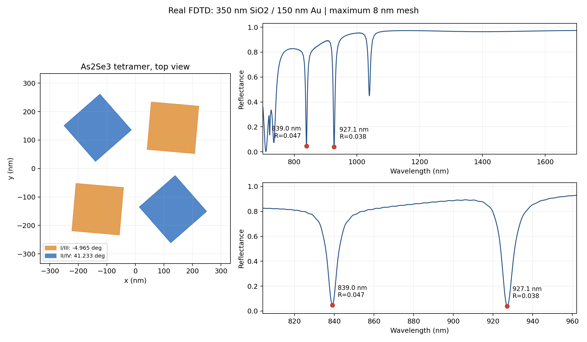
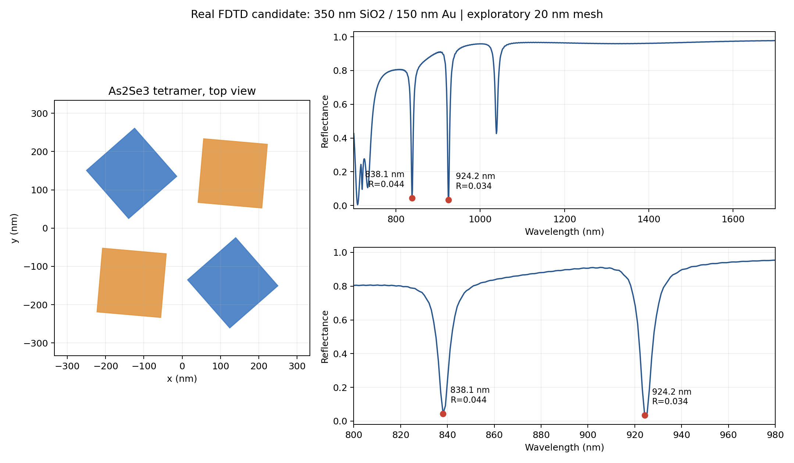
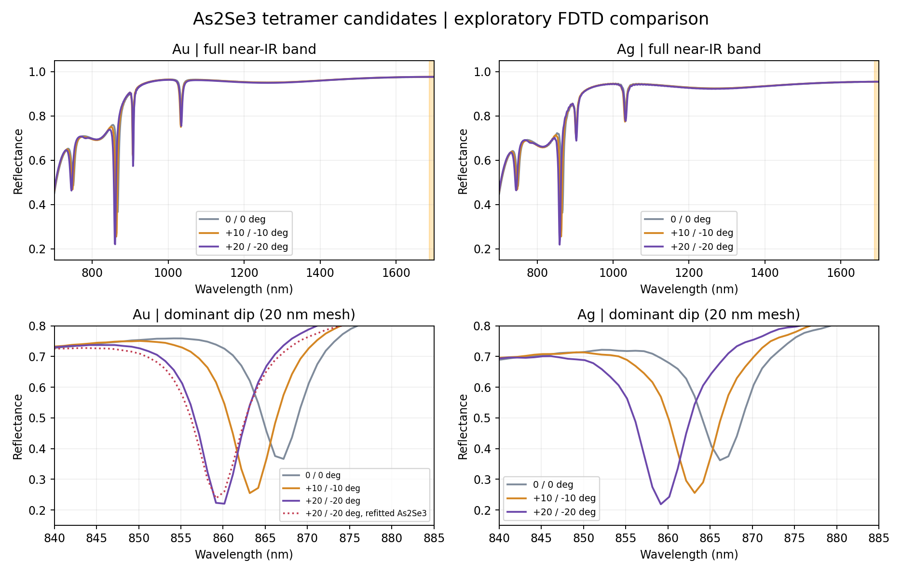

# As₂Se₃ 四聚体：七参数近红外逆向设计

由原 Metaformer 项目建立的独立项目，原 `D:\projects\LumOpt_test` 未修改。开发仓库为 `D:\projects\Metaformer_As2Se3`，代码编辑在 Git worktree `D:\projects\Metaformer_As2Se3_dev`、分支 `codex/as2se3-metal-quadrants` 中进行。

目标波段 **700–1700 nm**。四个 As₂Se₃ 方柱位于有限厚 SiO₂ 基板上，Au 或 Ag 膜位于基板底部。七个输出按 `[P, L, H, dX, dY, theta_odd_deg, theta_even_deg]` 排列；前五项为 nm，后两项为 deg。第一/第三象限共享奇数角，第二/第四象限共享偶数角，各柱绕自身中心旋转。两个角独立；`+δ/−δ` 是可选扫描路径。

代码内部使用 `p,l,h,alpha_x,alpha_y` 表示五个长度。dX/dY 是未旋转方柱的名义边缘间距，中心位置由 `(L+dX)/2`、`(L+dY)/2` 确定；旋转后的碰撞和周期单元越界由多边形检查拒绝。方柱具有90°周期等价性，训练对两个角分别使用周期损失。

## 已完成的真实结果

**正式计算网格要求：全部低于10 nm。** 新数据采集默认使用`as2se3_au_fine8.json` / `as2se3_ag_fine8.json`，整个计算域的网格最大步长设为8 nm，金属z方向2.5 nm；求解前读取真实x/y/z网格坐标，若任一单元超限就拒绝运行。8 nm双谷候选已完成，实际x/y最大7.944 nm、z最大7.987 nm；5 nm进一步复核正在计算。以下20 nm结果仅为要求提出前的初筛记录。

已完成8 nm、3000点真实光谱：两处主谷**839.046 nm / R=0.04707**、**927.076 nm / R=0.03849**，间隔88.029 nm。原生FSP独立重载后，四柱尺寸/奇偶角/材料、有限基板与底部Au层、源与网格均通过核对，导出R/T/A与原生光谱逐点一致。证据见`research_results/double_dip_controls8/`。目前该六组正式对照只完成1/6，不能宣称完整角度/Au/Ag对照或最终网格收敛。



14组 Au/Ag/裸基板对照和5组 As₂Se₃ 材料重拟合对照均已由本机 Lumerical FDTD 求解。固定 P=660、L=190、H=300、dX=dY=120 nm，角度从0/0到+10/−10、+20/−20时，约860 nm的反射谷加深并略微蓝移。20 nm网格下，Au主谷R约0.366→0.255→0.220，Ag约0.362→0.256→0.219。材料重拟合改变绝对谷深，但保留这组趋势。

按照新的双谷目标，12组真实七参数随机样本中找到主双谷候选：P=667.282、L=167.037、H=369.490、dX=97.049、dY=118.955 nm，奇数角−4.965°、偶数角41.233°，Au背板。初始1000点光谱的两个主谷位于838.138/924.224 nm，R=0.0442/0.0340；改进As₂Se₃损耗拟合后的3000点光谱仍保留约838.046/925.075 nm双谷，R=0.0358/0.0258。全波段还存在其他光谱特征。

这些是候选筛选结果，**尚未证明最终网格收敛、金属材料拟合精度或模态来源**。七输出网络与数据接口通过48项软件测试。12组初筛真实样本完成两轮训练、10次优化更新及权重重载审计；这是流程验证，测试误差尚未优于均值基线，不能视为可靠逆向设计模型。





详细数值、计算条件和限制见[初步研究结果](docs/initial_research_results.md)。完整原始光谱、来源指纹和测试记录见 `research_results/`；大型 `.fsp` 和训练权重不提交到Git。

## 使用

在 PyCharm 中打开本项目工作树，选择 `D:\Anaconda3\envs\transformer_env\python.exe`，或安装 `requirements.txt`。Lumerical 路径在配置的 `lumapi_path` 中；迁移机器时需要修改。以下命令在本项目根目录运行。

```powershell
# 检查真实 FDTD 接口及材料
python generate_dataset.py doctor --config configs/as2se3_au_fine8.json
# 固定尺寸的 Au/Ag 角度对照；可断点续算
python explore_spectra.py plan
python explore_spectra.py run
# 读取已提交结果绘图，无需运行 FDTD
python plot_research_summary.py
# 检查七输出网络并保存结构图；不依赖尚未采集的训练数据
python draw_metaformer.py --sampling-config configs/as2se3_au_fine8.json --output-dir docs/figures/as2se3
# 8 nm整个计算域：随机七参数数据采集及两轮训练流程检查
python generate_dataset.py generate --config configs/as2se3_au_fine8.json
python train_metaformer.py --config configs/train_as2se3_fine8.json
python audit_quadrant_pilot.py --sampling-config configs/as2se3_au_fine8.json --training-config configs/train_as2se3_fine8.json
python plot_training.py --output-root runs/as2se3_au_fine8
# 双谷候选：固定尺寸和平均角，扫描奇偶象限角差，比较Au/Ag
python explore_double_dips.py plan
python explore_double_dips.py run
# 5 nm空间网格复核，使用独立输出目录；可断点续算
python explore_double_dips.py run --case-id Au_full_difference --mesh-nm 5 --monitor-downsample-xy 2 --output data/double_dip_fine5_checked
# 完成求解后：独立重载原生项目，并同时比较两处谷的网格稳定性
python audit_double_native.py
python export_double_results.py
python compare_double_mesh.py
# 5 nm求解完成后，顺序执行原生审计、两谷比较、六组8 nm对照和真实8 nm训练流程
python continue_strict_research.py
```

5 nm复核保留3000个完整波段采样点。为适应本机内存，主远场监测器每两个空间网格点记录一次，记录间距仍低于10 nm；同时增加全空间采样监测器，在两谷附近及全波段检查点核对积分功率，R误差超过0.002或T误差超过10⁻⁵就拒绝结果。求解网格不被此存储选项改变，详见[双谷研究记录](docs/double_dip_research.md)。

`configs/as2se3_ag_fine8.json` 用于 Ag 正式数据采集；`*_pilot.json`和`as2se3_au_refit.json`仅保留已计算粗网格结果的原始配置与指纹。更改结构、材料、网格、波段或采样计划时使用新的输出目录，避免混合不兼容数据。

已加入专用于本项目的 PyCharm `.run/` 入口。数据生成前先完成环境检查；训练入口需要先生成七参数数据集。两轮训练配置用于接口验证。

## 材料和下一步

As₂Se₃ 使用 Joseph 等实测薄膜 n/k，来源与许可见 [materials/README.md](materials/README.md)。数据覆盖至1688 nm，1688–1700 nm采用显式端点延拓。当前350 nm基板为薄膜结构；若实物使用毫米厚基片，必须重新设置基板和背面金属传播模型。

研究流程、角度均值/差值扫描、尺寸扫描及目标谱导入方法见[近红外研究计划](docs/near_ir_research_plan.md)。当前目标为双谷或其他明显特征谱，尚未限定中心和线宽。双谷的判据、原始数据、训练审计见[双谷研究记录](docs/double_dip_research.md)。支持用 `explore_spectra.py --target-csv` 比较后续指定目标。

原五/六参数模型的历史说明归档至 [legacy_metaformer_readme.md](docs/legacy_metaformer_readme.md)；其中原项目的数据、训练记录和4–8 μm结果属于历史参考。本项目没有复制其大型数据及权重。
