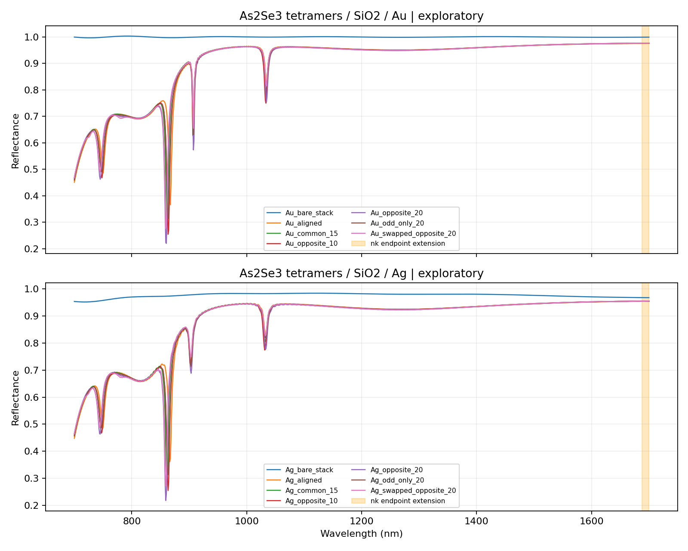
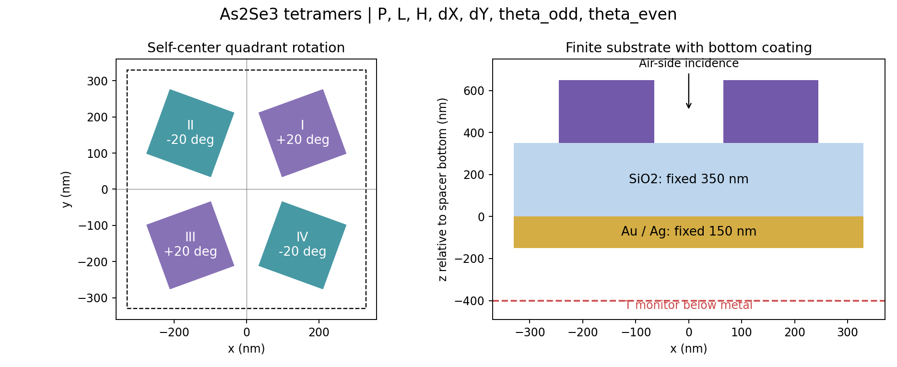

# 第一轮近红外特征谱探索：真实 FDTD

原项目未修改。所有光谱由本机 Lumerical FDTD 2024 R1（8.31.3633）实际求解得到；14/14 达到自动关断（status=2），通过 R/T 能量检查。**这是工程探索结果，尚未达到最终材料及网格收敛标准。**

固定尺寸：P=660、L=190、H=300、dX=dY=120 nm。As₂Se₃ / 350 nm SiO₂ / 150 nm 金属膜 / 空气；空气侧 x 偏振垂直入射。长度网格20 nm，金属 z 网格5 nm，自动关断阈值1e−5。波段700–1700 nm，1000点；1688–1700 nm为已明确标记的材料端点延拓。

## 可检验的趋势

沿平均角 m=0，差角 δ 从0增大到10°和20°，Au、Ag 两组中约860 nm的反射谷均变深并稍蓝移。该趋势来自相同几何尺度与基板条件下的角度扫描。只能称为当前网格与材料模型下的观察；不能由此推断任意角度或任意尺寸下都单调。

- Au：谷位置867.2→863.2→860.2 nm，R谷底0.366→0.255→0.220。
- Ag：谷位置866.2→863.2→859.2 nm，R谷底0.362→0.256→0.219。
- 裸基板/金属对照没有达到 prominence≥0.10 的反射谷。
- 主谷附近约5–6个波长采样点；它可用于候选筛选，线宽还需提高光谱分辨率复核。
- 约907 nm的窄特征很多只有约3个采样点，因此没有把它当作已充分解析的主候选。
- 交换 ±20° 两组角与整体90°旋转相关，Au/Ag的最大R差约0.125/0.063，提示偏振响应值得进一步研究；这不是镜像等谱验证。

## 主谷筛选表

“宽度”使用半 prominence 宽度，不能自动当作模态FWHM或Q。主谷筛选要求至少5个采样点。

| 案例 | 奇/偶角度 (deg) | 主谷 (nm) | R谷底 | prominence | 宽度 (nm) |
|---|---:|---:|---:|---:|---:|
| Au_opposite_20 | +20/-20 | 860.2 | 0.220 | 0.517 | 5.73 |
| Au_opposite_10 | +10/-10 | 863.2 | 0.255 | 0.496 | 5.78 |
| Ag_opposite_20 | +20/-20 | 859.2 | 0.219 | 0.483 | 5.86 |
| Au_swapped_opposite_20 | -20/+20 | 859.2 | 0.277 | 0.463 | 5.42 |
| Ag_opposite_10 | +10/-10 | 863.2 | 0.256 | 0.458 | 5.91 |
| Au_common_15 | +15/+15 | 861.2 | 0.292 | 0.458 | 5.40 |
| Au_odd_only_20 | +20/+0 | 863.2 | 0.313 | 0.435 | 6.01 |
| Ag_swapped_opposite_20 | -20/+20 | 859.2 | 0.272 | 0.432 | 5.63 |
| Ag_common_15 | +15/+15 | 861.2 | 0.296 | 0.418 | 5.62 |
| Ag_odd_only_20 | +20/+0 | 863.2 | 0.314 | 0.397 | 6.27 |
| Au_aligned | +0/+0 | 867.2 | 0.366 | 0.393 | 5.58 |
| Ag_aligned | +0/+0 | 866.2 | 0.362 | 0.360 | 5.82 |
| Au_bare_stack | +0/+0 | — | — | — | — |
| Ag_bare_stack | +0/+0 | — | — | — | — |

## 数据与边界

原始结果、来源指纹、每个样本的SHA256、材料拟合表及42项软件测试记录保存在 `research_results/`；原始`.fsp`保存在开发工作树的 `data/near_ir_study/projects/`，未提交到Git。研究流程与命令见 `near_ir_research_plan.md`。

材料使用有损实测薄膜n/k；材料工艺与厚度的差异需要后续灵敏度检查。当前Au Palik原生拟合仍有明显误差，不能据此发布精确吸收率或模态Q。七输出Metaformer及训练接口已实现并测试，但尚未训练具有可靠泛化精度的七参数模型。

## As₂Se₃ 材料重拟合对照

保持20 nm几何网格，采用更准确损耗拟合（tolerance=0，imaginary weight=2）的5组Au对照也已实际完成。未旋转、±10°、±20°的主谷依次约为866.2、863.2、859.2 nm，R谷底约为0.392、0.280、0.238。相反旋转使谷加深并稍蓝移的观察仍存在，但绝对谷底有所变化，说明材料拟合会影响数值结果。材料对照与网格对照分别保存。
