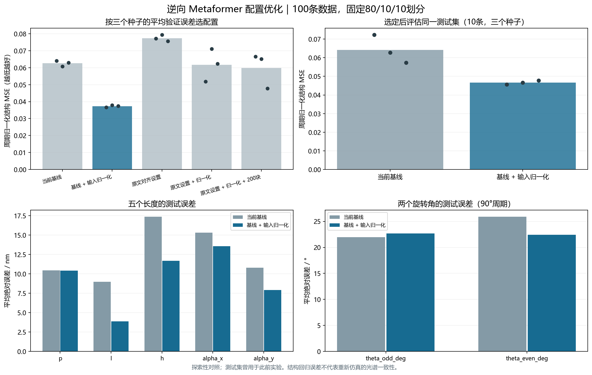

# 逆向 Metaformer 优化：100 条数据的配置对照

本次只处理反射光谱 → 七个结构参数。代码位于独立工作树 `D:/projects/Optics_design_inverse_optimization`，分支 `codex/metaformer-inverse-optimization`，由移除 ResNet 后的 `93e0bce` 建立。原项目保持原状。

## 采用的配置

验证集选出 `baseline_standard`：保持原有 10 层、10 头、每头 64 维、128 维嵌入、GELU、Pre-LayerNorm 和 AdamW，只加入按波长位置的训练集输入归一化。1000 点反射光谱仍分成 100 个块，每块 10 点。


每个波长的处理为 `z = (R - μ_train) / max(σ_train, 0.02)`。统计量只来自 80 条训练光谱，推理直接复用检查点中的统计量。固定下限 0.02 在实验前确定，用于避免极小标准差放大残差。固定的变换可以还原，保留绝对反射率信息；没有对每条光谱分别拉伸，也没有人为移动或加深反射谷。

可训练参数仍为 **3,998,087**；增加的是 2000 个均值/尺度浮点缓冲值和一个已拟合标记。注意力换用 PyTorch SDPA 计算接口，保留原来的投影权重和可导出注意力图的路径，并通过输出及梯度等价性检查。未加入额外的 ResNet、LSTM 或场强支路。

## 对照如何进行

使用 `examples/au100_metal8_100/dataset.npz`，固定 80/10/10 划分、随机种子 42/43/44，共 5 配置 × 3 种子 = 15 次实际训练。所有配置使用同一周期角损失、学习率 0.0003、批量 8、最多 100 轮、早停耐心 20；累计完成 612 轮、训练循环约 210 秒。CUDA 混合精度用于训练，验证和测试使用 FP32，关闭 TF32。

实验计划在首个权重更新前保存。候选试验只评估训练集和验证集；先按三个种子的平均最佳验证 MSE 选配置，再评估基线及选中配置的测试集。没有用测试集选择配置或种子。发布的单个权重取选中配置中验证误差居中的种子 **44**。

| 配置 | 三种子验证 MSE，均值 ± 样本标准差 | 参数量 |
|---|---:|---:|
| 当前基线：GELU / PreLN / AdamW | 0.062597 ± 0.001697 | 3,998,087 |
| **基线 + 训练集输入归一化** | **0.037312 ± 0.000657** | **3,998,087** |
| 原文对齐组合：ReLU / PostLN / Adam | 0.077322 ± 0.001879 | 3,998,087 |
| 原文对齐组合 + 输入归一化 | 0.061733 ± 0.009601 | 3,998,087 |
| 原文对齐组合 + 输入归一化 + 200 块 | 0.059807 ± 0.010418 | 3,997,447 |

原文对齐组合同时改变了激活、归一化位置和优化器，结果只能评价整个组合，不能单独归因到其中某一项。当前数据量和学习率下，它没有胜出；没有据此断言原文设置普遍较差，也没有单独检验“基线 + 200 块”。

[Gao 等原文](https://doi.org/10.1002/advs.202405750)及补充材料报告逆向参数量 4,262,173；当前七输出实现为 3,998,087。本文中的原文对齐组合只对齐已核实的部分设置，仍保留本地池化、回归头及小数据训练安排，不等同于作者代码的完整复现。最终选用的仍是本地 GELU / PreLN 配置。

## 选定后的测试结果

以下均为三个种子的平均值；角度误差按 90° 周期计算。

| 指标 | 基线 | 选中配置 |
|---|---:|---:|
| 七参数归一化 MSE | 0.064138 | **0.046654** |
| MSE 的种子间标准差 | 0.007515 | 0.001052 |
| P 的 MAE / nm | 10.44 | 10.41 |
| L 的 MAE / nm | 9.00 | **3.88** |
| H 的 MAE / nm | 17.37 | **11.68** |
| dX 的 MAE / nm | 15.31 | **13.58** |
| dY 的 MAE / nm | 10.78 | **7.92** |
| 奇数象限角 MAE / ° | 21.95 | 22.70 |
| 偶数象限角 MAE / ° | 25.89 | 22.45 |

测试 MSE 约下降 **27.3%**，主要收益来自长度回归。两个角度仍接近在 90° 周期上随机猜测的期望绝对误差 22.5°，不能声称角度已被可靠辨识，也不能据此判断角度在物理上无关。

按 10 个测试样本 ID 配对、先平均三个种子的误差再重采样，MSE 差值“选中配置减基线”的探索性 95% bootstrap 区间为 `[-0.02848, -0.00674]`。三个种子复用了同一组测试样本，不是 30 个独立测试样本。这 10 条测试光谱也曾用于此前实验，结果需要更多新数据独立确认。



数据沿用历史 1.0 的底部 Au / 有限厚 SiO₂ / 四聚体结构，质量标记仍为 `pipeline_validation`，既有金属材料拟合限制没有在这轮修复。这里验证的是逆向回归流程。参数误差不能替代预测结构重新仿真后的光谱一致性，也没有证明 Q 值、BIC 或场增强。预测结果仅受参数上下界约束，旋转后的几何碰撞仍需检查。

## 在 PyCharm 使用

打开本分支中的 `Metaformer_As2Se3` 文件夹，解释器使用 `D:/Anaconda3/envs/transformer_env/python.exe`。已有依赖无需增加包。运行配置：

- `06 Train selected inverse`：用选中配置重新训练，结果写入新的 `runs/inverse_selected`。
- `07 View inverse comparison`：查看本次图表，不重新训练。
- `08 Predict inverse geometry`：读取已发布权重，对样本 ID 1 直接预测七参数。

命令行在该文件夹执行：

```powershell
python predict_inverse.py --sample-id 1
python predict_inverse.py --spectrum path/to/spectrum.csv --output tmp/prediction.json
python plot_inverse_optimization.py --show --no-save
python train_metaformer.py --config configs/train_inverse_selected.json
python verify_inverse_results.py
```

外部 CSV 必须包含 `wavelength_nm,reflectance` 列，并与检查点的 1000 点波长网格一致。推理入口会检查网格、长度及有限值，自动完成归一化和物理单位还原。

复跑完整配置对照用 `python optimize_inverse.py`。试验目录为 `runs/inverse_ablation`，包含计划、进度、完整日志、最佳权重和断点；相同计划可以继续已完成/中断的试验。修改源文件或数据后应使用新的 `--work` 和 `--output` 目录。替换为新数据时，同时修改训练 JSON 的 dataset 路径，输入统计量将重新只在新训练集拟合。

## 交付与核验

`results/inverse_au100_ablation/summary.json` 保存配置、划分、每种子的验证/测试指标和源文件哈希；同目录包含六份测试预测 CSV、训练曲线历史、对照图、权重说明和核验结果。`models/inverse_au100_selected.pt` 包含种子 44 的权重、输入统计量、波长网格、参数上下界和来源信息。

16 项相关单元测试通过，涵盖注意力输出/梯度、旧配置兼容、输入统计量保存、测试集隔离、真实优化更新、断点续训和推理物理单位还原。独立核验重新计算了选择结果和 CSV 指标，重载预测最大差约 `5.96e-8`，CPU/CUDA 最大差约 `2.68e-7`。本机 CPU 四线程、FP32、预热后单条模型前向中位数约 **9.4 ms**，不包含载入和文件读取；这只是网络推理耗时。
