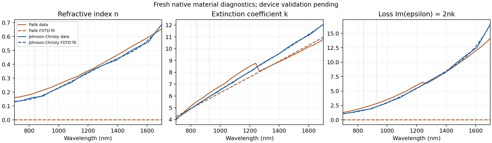

# 金属拟合诊断与后续验证

2026-10-12，在不镀金4 nm组继续计算期间，独立创建空白Lumerical会话检查金属拟合。没有载入或更改正在运行的FSP、默认材料库、四组控制配方或已发布数据生成包的默认物理设置；没有额外启动FDTD引擎。

七个完整诊断实验的指标、原生版本及原始导出校验值保存于 `research_results/metal_fit_diagnostics/summary.json`。各CSV仍保存在本机 `data/metal_fit_*_20261012/`；Git归档汇总指标和图，不另行分发金属数据库表。原始报告的scope用library copies描述临时材料；resample=true时实际新建临时采样材料，具体方式以该标记与prepared_data_points为准。

## 实际发现

Au Palik默认拟合的n接近零，虽然k为正，但 `Im(epsilon)=2nk`几乎为零。700–1700 nm中复介电常数最大相对误差约21.52%，损耗项相对误差约100%。提高损耗权重、改变系数数目或加密同一数据都没有得到兼顾实部与损耗的可靠改进；部分设置返回负k，按当前无增益检查排除。取消数值稳定性约束也未解决问题。

进一步检查了CRC和Johnson–Christy的Au数据源。CRC同一数据加密后，4系数、权重10的复介电常数/损耗最大相对误差约1.65%/6.22%。Johnson–Christy加密后、8系数、权重10约为**1.62%/5.33%**，n/k最大绝对误差约0.01641/0.08899。加密保留源表原有频率节点，另外添加1000个波长采样；用4001个其他波长检查新材料数据与同一库原始数据的折射率差≤1e−7。增加采样不是新增实测数据。



Johnson–Christy的Au/Ag数据在Ansys材料库文档中对应1972年已发表的贵金属光学常数测量；CRC的Au条目对应Olson、Lynch、Weaver的未发表数据。来源不同不等于只改变拟合参数，必须分别标记；不能与原Palik结果混成同一受控矩阵。依据：[Ansys材料数据库来源](https://optics.ansys.com/hc/en-us/articles/360034394614-Material-Database-in-FDTD-and-MODE)。

## 选择与限制

下一步的Au候选是同一Johnson–Christy数据的加密导入、最多8系数、tolerance=0、imaginary weight=10，保留make-fit-passive和improve-numerical-stability约束。**它只通过材料诊断，尚未完成该设置下的器件时域求解。** 需保存独立配方、验证实际材料与几何、检查自动关断、再核对双谷及E/H；不能以较小材料误差替代器件网格/场收敛。

Ag Johnson–Christy加密后仍有较大的最大相对损耗误差，当前不据此替换已有Ag Palik设置。不同来源的实际薄膜厚度、制备工艺与数据差异仍需在实物设计中考虑。

四组Au/无Au、8/4 nm对照保持原设置，最终材料审计按保存FSP实际使用的模型报告。当前报告结论限定在这个模型下。材料修正后的结构检查属于后续独立验证，不伪装成已经算完的对照结果。

```powershell
python compare_metal_fits.py --resample --metals "Au (Gold) - Johnson and Christy" --coefficients 4 8 --weights 1 10 --destination data/new_jc_fit_diagnostic
```
