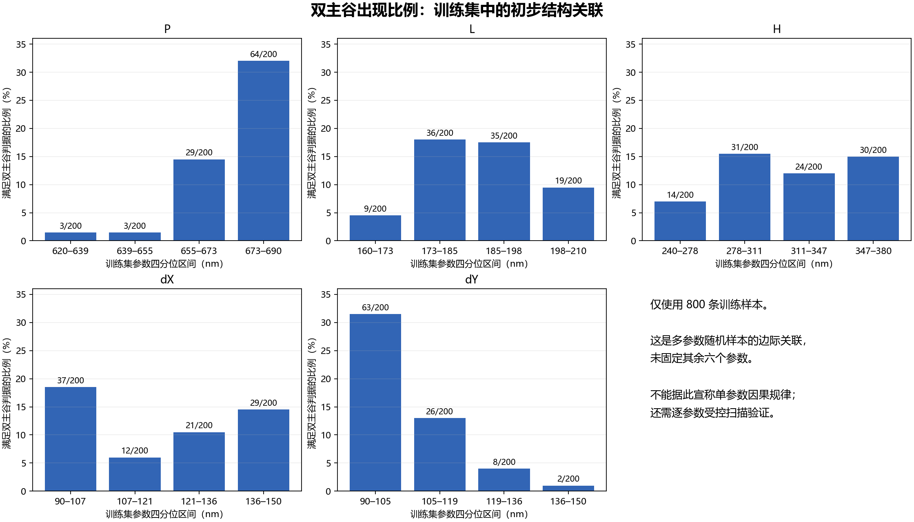
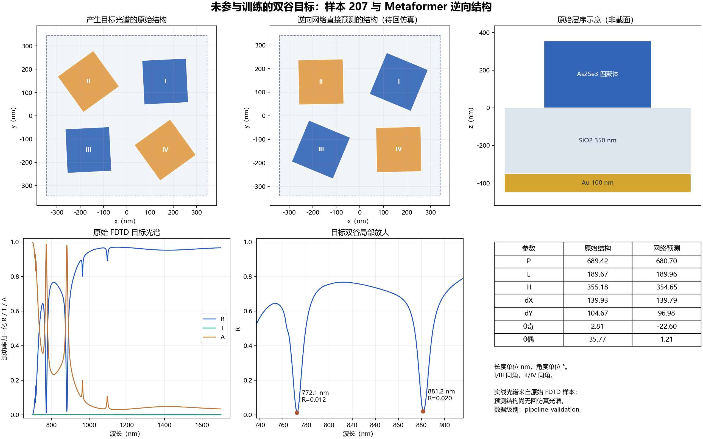

# 1000 样本中的双谷目标、结构关联与逆向候选

更新：筛选之后已完成[样本 207 的原始结构对照及预测结构回仿真](../inverse_roundtrip_207/report.md)。双谷保留，中心偏移约 1.0/4.0 nm；第二谷位移未通过 2 nm 参考标准。下文图表和 `analysis.json` 保留验证前的候选记录，626、689 尚未回仿真。

材料限制：这批数据的 Au 拟合几乎丢失欧姆损耗。下述结构关联和双谷候选均限于这套数值材料体系；在材料修正并重新求解前，不能把它们当作真实 Au 器件的设计规律。

这份分析继续使用已核验的生成器 1.0 数据及冻结的逆向 Metaformer。没有改动训练划分、权重或已报告测试指标，也没有运行正向网络或新的电磁仿真。

## 观察到的结构关联

沿用已有主双谷判据：两个谷各自 R≤0.2、突出度≥0.4、半突出度宽度至少跨 5 个波长网格间隔；两谷分离至少 30 nm、谷间反射抬升至少 0.2，中心距波段两端超过 30 nm。

1000 条光谱中 **133 条**符合这一“两个主谷”判据，分别为训练集 99、验证集 19、测试集 15。此前未出现的 88 个测试结构中有 12 条符合。

仅在 800 条训练数据中划分各参数的四分位区间，可以观察到：P 最高四分位约 673–690 nm 内，双主谷出现率为 **64/200=32%**；P 低于约 655 nm 的两组均为 **3/200=1.5%**。dY 最低四分位约 90–105 nm 内为 **63/200=31.5%**，最高四分位约 136–150 nm 内为 **2/200=1%**。

据训练集四分位边界定义探索性区域 **P≥672.663 nm 且 dY≤105.400 nm**，其他五参数仍覆盖原随机范围：

| 划分 | 区域内双主谷 | 区域外双主谷 |
| --- | ---: | ---: |
| 训练 | 39/55（70.9%） | 60/745（8.1%） |
| 验证 | 5/7（71.4%） | 14/93（15.1%） |
| 测试 | 3/6（50.0%） | 12/94（12.8%） |

较大的 P、较小的 dY 是当前数据中值得进一步受控扫描的组合。该结果是多参数随机样本的关联，区域内测试结构仅 6 个；它没有固定其余五参数，不能当作因果机制或普适设计规律。它也不证明角度影响很小。

## 较干净的双谷目标

为符合“希望只有两个明显谷”的意图，进一步要求在现有采样中，突出度至少 0.10 且宽度至少跨 5 个网格间隔的谷恰好有两个。按原主双谷分数排序，从此前未出现的测试结构中选出以下三个目标；它们都没有参与模型训练。

| 样本 ID | 谷1中心 / R | 谷2中心 / R | 两谷半突出度宽度 |
| --- | --- | --- | --- |
| 207 | 772.072 nm / 0.01202 | 881.181 nm / 0.01990 | 9.675 / 12.146 nm |
| 626 | 772.072 nm / 0.14142 | 875.175 nm / 0.19405 | 7.295 / 9.216 nm |
| 689 | 746.046 nm / 0.18717 | 879.179 nm / 0.11791 | 8.217 / 8.256 nm |

这一过滤仍不排除更弱或尚未解析的附加谱线，半突出度宽度也不等于模态线宽，未据此计算 Q 值。

## 输入目标光谱后的网络输出

下面以样本 207 为例。目标是原始 FDTD 反射光谱，预测结构取已冻结模型的直接输出；原始结构仅作为对照，没有按结构距离检索模型答案。

| 参数 | 产生目标光谱的原始结构 | Metaformer 输出 |
| --- | ---: | ---: |
| P | 689.422 nm | 680.704 nm |
| L | 189.669 nm | 189.964 nm |
| H | 355.181 nm | 354.645 nm |
| dX | 139.927 nm | 139.789 nm |
| dY | 104.666 nm | 96.984 nm |
| 第一/第三象限角 | 2.811° | −22.596° |
| 第二/第四象限角 | 35.770° | 1.208° |

尺寸较接近而角度差异较大。逆向映射可能存在多解，参数误差无法单独判定新结构是否保留双谷；**预测结构仍需回仿真**。图中的 R/T/A 实线全部来自原始样本，尚无预测结构的光谱。

`analysis.json` 保存全部 133 组排序、三个目标及其预测七参数、关联统计和数据/权重哈希；`double_dip_ranking.csv` 方便筛查；`target_*.csv` 为三个原始目标的 R/T/A。重现命令为 `python analyze_feature_targets1000.py`。

本结果限于 **As2Se3 / 350 nm SiO2 / 底层 Au 100 nm**、700–1700 nm、金属局部 8 nm 网格的旧层序，数据级别仍为 `pipeline_validation`。不能直接移用到 2.0 的厚 SiO2 / 中间 Au / 四聚体结构，也尚不能宣称已验证 BIC、模态身份或 Q 值。
