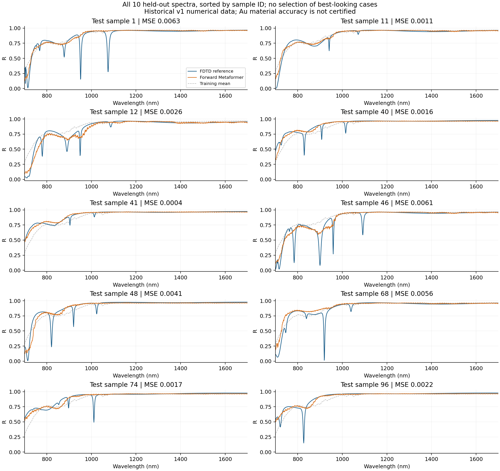
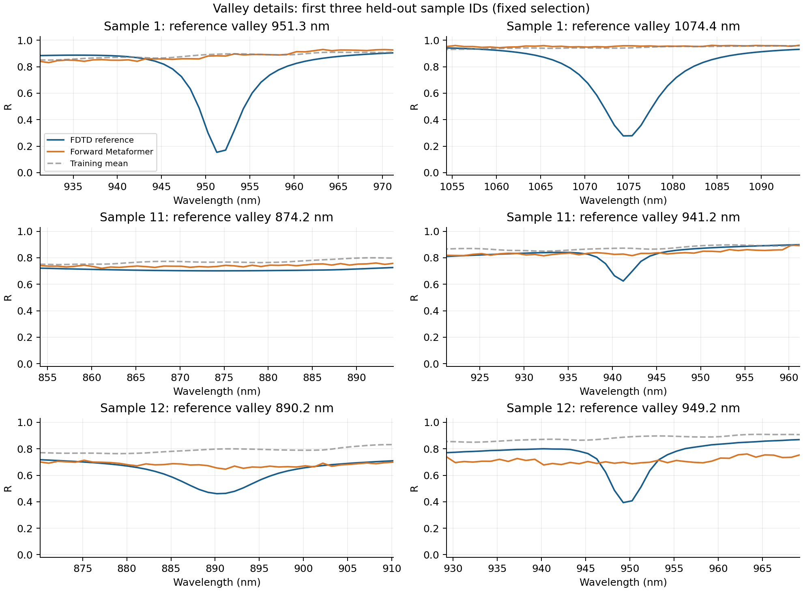
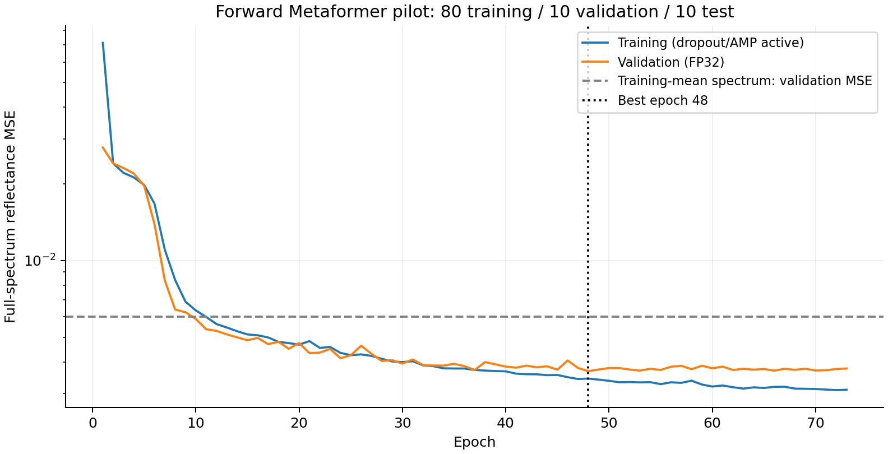

# 正向 Metaformer 首轮结果

七参数结构到 1000 点反射光谱，598,026 个参数；未接入逆向闭环，未训练 T。

固定 80/10/10 划分、seed=42。完成 73 轮、730 次实际更新，验证集按 min_delta=1e-5 的改善阈值选择第 48 轮。测试集只在模型选择结束后评估，未根据测试结果调参。

| 测试指标 | 数值 |
|---|---:|
| 整谱 MSE | 0.00315906 |
| 训练集均值光谱基线 MSE | 0.00556541 |
| 相对基线的整谱 MSE 降低 | 43.24% |
| 反射率 MAE | 0.022657 |
| 两个主要目标谷匹配数 | 10/20 |
| 已匹配谷中心 MAE | 7.808 nm |
| 已匹配谷谷底反射率 MAE | 0.382 |
| CPU 检查点重载与 GPU 最大差值 | 2.68e-07 |

**首版已经学到部分结构相关的宽带变化，窄谷仍被明显抹平或遗漏。** 整谱平均误差的改善不能证明双谷设计成功，尚不适合作为高精度逆向约束。匹配误差只统计匹配成功的谷，缺失的 10 个谷另计，不能忽略。

图中蓝线为 FDTD 标签、橙线为神经网络预测、灰线为训练集均值。全部 10 条测试样本按 ID 排列；局部图固定选择 ID 最小的三条，不挑选表现好的样本。

在当前电脑 CPU 上，batch=1、4 线程、FP32 的网络前向中位耗时 2.914 ms。计时已预热 10 次、测量 100 次；不含加载、归一化和 CSV 写入。这是运行速度，不是精度承诺。

原始数据 SHA256：`591ca0f4d9f4fc0be9803f3a566f72eee1ee3ac871ad9d03472b93a732aed0e3`。这是历史 v1 Au100/有限 SiO2 数据，质量为 pipeline_validation，不能混同新版结构或认证 Au 耗散。完整数值、来源指纹、预测数组和代码哈希保存在本目录 JSON/NPZ 中；可移植权重位于 `../../models/forward_au100_seed42.pt`。
