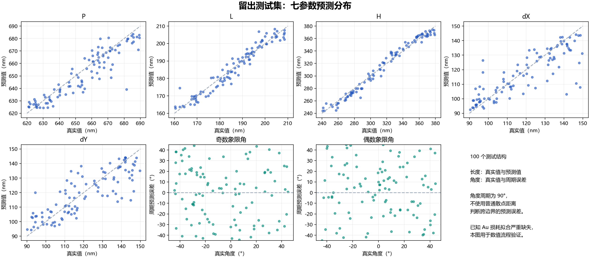

# 1000 样本逆向 Metaformer 训练与验证

1000 个原始 FDTD 样本全部校验通过，固定划分为训练 800、验证 100、测试 100。训练完成，五个尺寸参数的预测明显优于常数基线，两个旋转角仍未有效超过周期常数基线。

材料更正：后续回仿真核对进一步确认，这批服务器数据也沿用了几乎丢失 Au 欧姆损耗的拟合，存档 Im(ε) 约为 1.69e-7–2.60e-6。这里的训练成绩用于验证数值流程；真实金器件的光谱预测需要修正材料后重新获取数据、训练和验证。[证据及回仿真记录](../inverse_roundtrip_207/report.md)

本次使用生成器 **1.0** 数据：从下到上为 Au 100 nm、有限厚 SiO2、As2Se3 四聚体，700–1700 nm、1000 点反射光谱，金属层局部 8 nm 网格。本次未使用 2.0 的厚基板/中间金膜数据。

## 数据核对

检查了 40 个原分片中的全部 1000 个 NPZ：SHA256、采样计划、样本 ID、几何标签、归一化、求解状态和实际网格记录均通过；原始样本与 `merged_recovered/dataset.npz` 中的 R/T/A 一致。全部状态为 2，金属区域实际最大网格步长约 7.733 nm。1000 组几何和光谱均无完全重复。原始数据包保持不变。

1000 个结构的前 100 个与先前的小样本集相同。当前 100 个测试结构中，有 7 个曾属于旧训练集、3 个曾属于旧验证集、2 个曾属于旧测试集。因此保留生成器原划分，同时单独报告另外 **88 个此前未出现的测试结构**。标准化统计量只由本次 800 条训练光谱拟合，没有对单条光谱做 min-max、平滑、截断或重采样。

## 模型和训练

沿用此前选定的逆向 Metaformer：线性光谱分块嵌入，100 个 patch、128 维嵌入、10 层编码器、10 个注意力头、每头 64 维，输出七参数，共 **3,998,087** 个可训练参数。未添加 ResNet、LSTM 或正向网络。

从头训练，固定 seed 44、batch 8、AdamW、初始学习率 3e-4、权重衰减 1e-3，最多 100 轮、20 轮验证停滞后早停。角度误差按正方形 90° 周期计算。RTX 3050 Ti 上使用混合精度，训练记录用时约 **141.5 秒**，共 **55 轮、5500 次优化更新**；以验证误差最低的 **第 35 轮** 权重进行最终评估。

## 测试结果

| 参数 | 模型 MAE | 训练集常数基线 MAE |
| --- | ---: | ---: |
| P | 6.05 nm | 16.92 nm |
| L | 2.50 nm | 11.13 nm |
| H | 5.16 nm | 35.39 nm |
| dX | 6.76 nm | 16.47 nm |
| dY | 7.65 nm | 15.42 nm |
| 奇数象限角 | 21.70° | 19.76° |
| 偶数象限角 | 20.73° | 22.17° |

基线的长度使用训练标签均值，两个角使用训练标签上的周期平方误差最优常数；两者均不读取输入光谱。最佳验证 MSE 为 **0.031602**，100 条测试 MSE 为 **0.033422**，基线为 **0.081123**，整体降低 **58.8%**。长度部分 MSE 降低约 **81.1%**，角度部分 MSE 比基线高约 **2.1%**。

在相同的 **88 个此前未出现的测试结构**上，旧 100 样本模型 MSE 为 **0.051754**，本次模型为 **0.034112**，降低 **34.1%**。两者使用同一模型配置，比较的是已冻结权重；没有用这 88 个结构重新选择超参数。




训练损失持续下降，而验证误差较早进入平台，说明继续训练当前配置不能保证更好的泛化。数据增多改善了五个尺寸参数，尤其是 H；两个角仍是主要短板。这不能证明角度对光谱的物理影响很小，也不能区分逆映射多解与网络学习困难。

## 保存和使用

- 模型：`models/inverse_au100_1000.pt`，保留了输入统计量、波长网格、参数上下界和训练来源。
- 复跑配置：`configs/train_inverse_1000.json`；PyCharm 配置 `09 Train inverse 1000`。
- 推理示例：PyCharm 配置 `10 Predict inverse 1000`。
- 本目录保存 `summary.json`、完整 `metrics.json`、训练曲线、验证/测试逐样本预测表及日志。

在 `Metaformer_As2Se3` 目录执行：

```powershell
python train_metaformer.py --config configs/train_inverse_1000.json
python predict_inverse.py --checkpoint models/inverse_au100_1000.pt --dataset examples/au100_metal8_1000/dataset.npz --sample-id 103
python summarize_train1000.py
```

已重载检查点并复算测试 CSV 指标，CPU 重载预测与导出 CUDA 预测的最大归一化差约 **8.94e-7**；标准化仅拟合训练集的记录已核对。100 条预测结构均通过现有几何合法性检查。

本训练总结记录单随机种子的结构回归评估，数据仍为 `pipeline_validation`，且存在已确认的 Au 损耗拟合严重缺失。[后续样本 207 的真实 FDTD 回仿真](../inverse_roundtrip_207/report.md)已完成：网络直接输出结构保留双谷，中心分别偏移约 1.0/4.0 nm，第二谷未通过 2 nm 参考门槛。该单例不能替代全部测试集的光谱统计，也不据此宣称真实器件的 Q 值或 BIC 性能。
