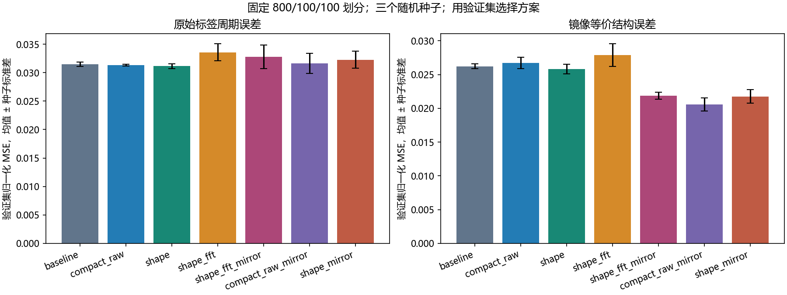
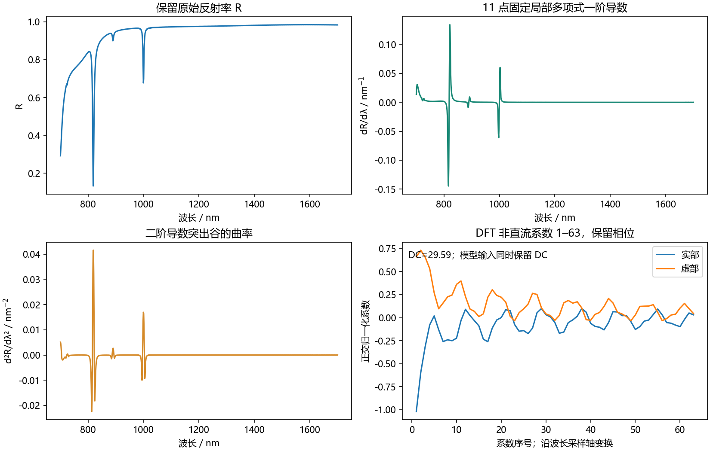
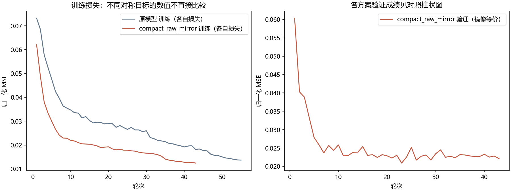

# 1000 样本逆向模型：光谱视图与镜像等价优化

日期：2026-10-22。使用现有生成器 1.0 数据，Au / 有限厚 SiO2 / As2Se3，700–1700 nm 反射率 1000 点。数据 SHA256：`0a06da7b6c194fb6e3d906fa11f8ca211a236c1aa83f6703c7489ad662ed972f`。不重算 FDTD，不改变原始数据、原模型或原权重。

**验证集选中 `compact_raw_mirror`。三个种子平均测试镜像等价 MSE 相对原模型降低 21.4%；原始标签周期 MSE 升高 0.9%。** 两种误差均报告，不能把只改变评价口径造成的下降称为网络改善。

## 实验与选择

固定训练 800、验证 100、测试 100；seed 42/43/44；每轮 batch=8、AdamW lr=3e-4、weight_decay=1e-3；最多 100 轮，20 轮停滞早停。所有标准化仅拟合训练集。基线 seed44 复用同一数据的历史冻结权重，其余从头训练。

每个训练运行按自身损失对应的验证误差选择 epoch；方案之间统一按三个种子的**平均镜像等价七参数 MSE**排名。`selection.json` 在任何本轮测试预测前落盘，只测试原模型与胜出方案。测试集此前已被检查，因此这是固定测试集上的后续实验，不是新的盲测。

先比较五个方案，随后在尚未打开测试预测时增加 compact_raw_mirror 与 shape_mirror，检查镜像损失的收益是否依赖傅里叶或导数分支。第一轮已有运行原样复用；最终在共七个方案之间按同一验证规则选择。完整配置为 `configs/inverse_feature_refinement.json`，这种验证集驱动的补充也会增加对验证集的适配，需以后用独立数据再确认。

| 方案 | 参数量 | 原始标签验证 MSE 均值 | 镜像等价验证 MSE 均值 ± 种子标准差 |
| --- | ---: | ---: | ---: |
| compact_raw_mirror | 320,552 | 0.031641 | 0.020595 ± 0.000971 |
| shape_mirror | 337,064 | 0.032288 | 0.021765 ± 0.000992 |
| shape_fft_mirror | 349,736 | 0.032795 | 0.021880 ± 0.000504 |
| shape | 337,064 | 0.031163 | 0.025823 ± 0.000739 |
| baseline | 3,998,087 | 0.031473 | 0.026224 ± 0.000356 |
| compact_raw | 320,552 | 0.031315 | 0.026701 ± 0.000848 |
| shape_fft | 349,736 | 0.033589 | 0.027900 ± 0.001668 |



## 预处理和架构

- compact_raw：96 维嵌入，4 层编码器，4 头、每头 24 维；100 个 10 点 patch；学习式加权池化。原模型为 128 维、10 层、10×64 注意力，约 400 万参数。
- shape：保留原始 R，同时计算 11 点、3 阶固定 Savitzky–Golay 一阶/二阶导数；10 点细分块与 50 点粗分块形成 100+20 token。这个对照同时增加形态通道与粗尺度，不能分拆归因。
- shape_fft：在 shape 上加入前 64 个复数 DFT 系数的实部和虚部，通过 128→96 投影形成 1 个全局 token。沿均匀波长轴计算，不解释为时间频谱或直接的光程；完整 R 始终保留，不是只用低频重建。
- shape_fft_mirror：相同网络，改为镜像等价联合周期损失。归一化角度变换为 `(u奇,u偶)→(1−u偶,1−u奇)`。两角**共同选择同一个等价分支**，不能各自挑最小误差。
- compact_raw_mirror / shape_mirror：分别在 compact_raw / shape 上仅更改镜像损失，形成必要的去分支对照。



法向线偏振、平面各向同性层和四聚体镜像对称性给出该等价关系。它减少一种逆映射冲突，不保证结构唯一，也不意味着角度没有光谱作用。该表示与损失组合属于本项目探索，未据此宣称论文层面的原创性。

## 最终测试

| 模型 | 原始标签周期 MSE | 镜像等价 MSE |
| --- | ---: | ---: |
| baseline，3 个种子均值 | 0.032750 | 0.026834 |
| compact_raw_mirror，3 个种子均值 | 0.033056 | 0.021085 |

| 参数 | 原模型 MAE，三种子均值 | 选中方案 MAE，三种子均值 | 单位 |
| --- | ---: | ---: | --- |
| P | 5.754 | 4.549 | nm |
| L | 2.163 | 2.062 | nm |
| H | 5.709 | 4.805 | nm |
| dX | 6.696 | 7.165 | nm |
| dY | 7.987 | 7.741 | nm |
| 奇数角 | 16.490 | 14.774 | ° |
| 偶数角 | 18.404 | 14.256 | ° |

上述 MAE 的角度按联合镜像匹配后统计，尺寸始终按原标签比较。另用训练标签拟合一个**不读取光谱**的镜像等价常数基线：测试等价 MSE 为 0.072618，两个角 MAE 分别为 14.31° / 17.10°（`constant_baseline.json`）。角度是否从光谱中学到信息还应与此基线比较，不能只与旧模型的原始标签误差比较。

本轮选中方案的奇数角尚未超过该常数基线，偶数角有所改善；角度辨识仍是短板。dX 的平均误差也略有上升，没有把总指标改善表述为所有参数同时改善。

每个种子及预先定义的三模型集成结果均保存在 `summary.json`；主结论使用三种子单模型均值，不把集成与单模型混比。镜像对齐后对角度作圆均值的集成尚需实际回仿真验证，不能凭结构参数平均假定其光谱也平均。



## 使用和核对

选中单模型使用验证表现居中的 seed `44`，权重 `models/inverse_features1000.pt`。本机 CPU 四线程、batch1 的暖机前向中位耗时 **2.302 ms**，原模型相同测法为 **10.125 ms**；包含预处理，不含文件/权重读取，不据此承诺其他机器的时延。保存重载与导出 GPU 预测最大归一化差 `5.96e-07`；导出指标复算通过。测试预测的几何合法性计数见 `verification.json`。

部署用 seed44 在 100 个测试结构上全部通过几何检查；另一个种子 seed43 有 1 个预测不合法。未根据测试合法性改选种子。推理入口返回 `geometry_valid` 和具体错误，后续新目标仍须逐条检查。

```powershell
python optimize_spectral_inverse.py all --config configs/inverse_feature_refinement.json
python summarize_feature_study.py
python predict_spectral_inverse.py --sample-id 207
```

解释器沿用 `D:/Anaconda3/envs/transformer_env/python.exe`，无需新增依赖。PyCharm 配置 `11 Optimize spectrum features 1000`、`12 Predict optimized inverse`。原有配置 09/10 保留。全部新实验、缓存、权重写入 D 盘。

配置中的 `historical_checkpoint` 是本机复用历史 seed44 的可选路径；另一台机器不存在此文件时，训练器会从头训练该种子，不要求复制整个旧工作树。完成的实验计划会检查代码和数据 SHA；修改配置/训练代码后应使用新的 `output_dir`。

## 结论范围

这批数据已知 Au 损耗拟合严重缺失；本次成绩只证明同一历史数值数据集上的学习效果。新版厚基板/中间 Au 器件和修正材料不在此训练数据内。未运行新 FDTD，因此不把参数 MSE 换算成谷位/线宽误差，也未认证 Q 或 BIC。新材料与网格问题不妨碍这里的算法对照，但真实器件设计仍需可靠数据和回仿真。
