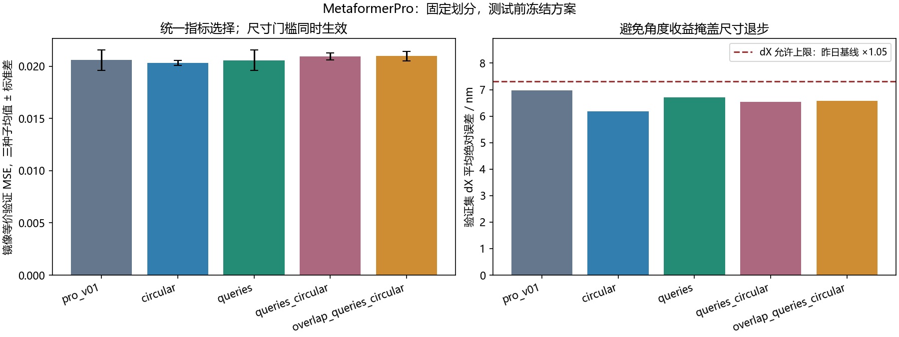
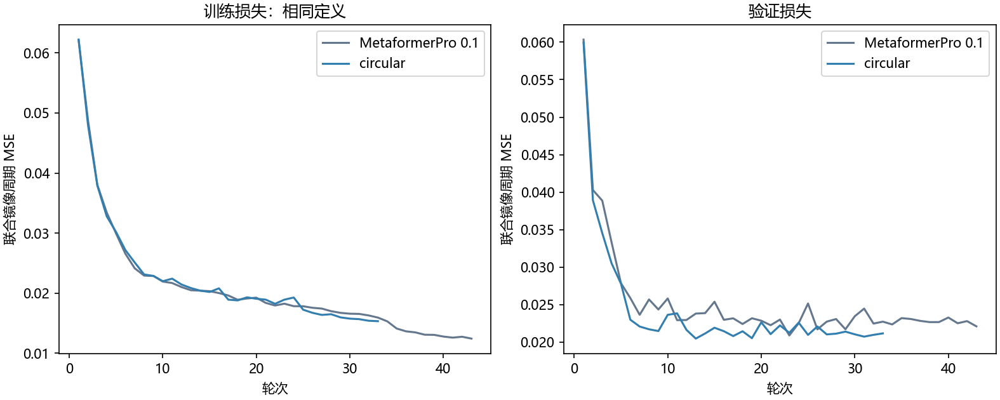
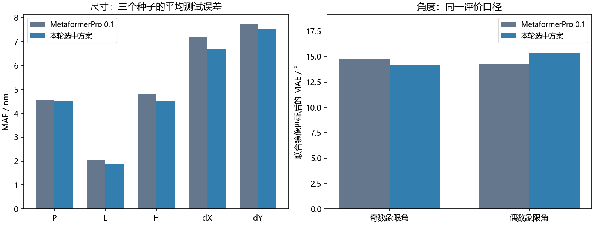

# MetaformerPro：圆周角度、参数查询与重叠分块对照

日期：2026-10-23。昨天选中的 compact_raw_mirror 命名为 **MetaformerPro 0.1**，本轮在独立分支 `codex/metaformerpro` 继续优化。原项目、原始数据和历史权重保留。

**验证规则选中 `circular`，代表 seed `44`。三个种子平均测试的五尺寸 MSE 相对昨日基线降低 3.4%，原始标签周期 MSE 降低 8.3%，镜像等价 MSE 升高 1.3%。** 所有口径同时保留，不把评价口径变化当成性能提升，也不把尺寸改进称为全面改善。

## 数据和选择规则

沿用 1000 条历史反射光谱，700–1700 nm、1000 点，固定 800/100/100 划分；数据 SHA256 `0a06da7b6c194fb6e3d906fa11f8ca211a236c1aa83f6703c7489ad662ed972f`。只训练逆向网络，没有新增正向网络或 FDTD 求解。已知这批 1.0 数据的 Au 损耗拟合存在严重偏差，本轮评价数值数据上的学习能力。

每个新方案 seed42/43/44，batch8、AdamW、lr=3e-4、weight_decay=1e-3，最多100轮，20轮停滞早停。标准化仅拟合训练集。三个昨日基线直接复用，转换后预测差记录于 `validation_results.json`，避免重训波动混入改进。

预先确定：先要求五尺寸验证 MSE 不超过昨日均值的1.02倍、dX验证MAE不超过昨日的1.05倍，再按平均联合镜像验证 MSE 选择方案；昨日基线可作为回退。`selection.json` 在本轮测试前保存。测试集此前已经检查过，因此本轮不是新的盲测。

| 方案 | 参数量 | 等价验证 MSE 均值 ± 种子标准差 | 五尺寸验证 MSE | dX验证MAE / nm | 尺寸门槛 |
| --- | ---: | ---: | ---: | ---: | --- |
| circular | 320,938 | 0.020312 ± 0.000251 | 0.012457 | 6.191 | 通过 |
| queries | 320,162 | 0.020579 ± 0.000994 | 0.012750 | 6.703 | 未通过 |
| pro_v01 | 320,552 | 0.020595 ± 0.000971 | 0.012401 | 6.970 | 通过 |
| queries_circular | 320,355 | 0.020948 ± 0.000327 | 0.013346 | 6.543 | 未通过 |
| overlap_queries_circular | 321,315 | 0.020978 ± 0.000452 | 0.012678 | 6.580 | 未通过 |



## 本轮结构改动

- pro_v01：昨天的小型网络，4层、96维、4头、每头24维，100个10点patch、学习式全局池化、7个Sigmoid输出。更名和移除未使用的FFT计算不改变其已保存预测。
- circular：仍输出7个物理参数；网络内部产生5个长度logit及两组cos/sin，共9个潜变量。令 `u=(θ+45°)/90°`，相位 `φ=2πu`，用atan2解码。最终仍按原定义的联合镜像周期MSE训练，不把损失换成数值范围更小的弦长误差。圆周向量的长度不作为置信度。
- queries：7个学习查询分别从编码token中池化特征，读出P/L/H/dX/dY和两个角，使各参数能够关注不同谱段；这类权重不是物理因果或能量分布。
- queries_circular：结合参数查询和圆周角度输出。
- overlap_queries_circular：20点窗口、10点步长、左右复制填充5点，仍产生100个token；相邻窗口重叠，保留跨分块窄谷信息，不对原始曲线做平滑或删峰。

选中配置：`{"readout": "global", "angle_head": "circular", "overlap": false}`。镜像标签变换仍为 `(u奇,u偶)→(1−u偶,1−u奇)`，两角必须共同选择同一等价分支。




## 最终测试

| 方案，均为三种子单模型均值 | 原始标签周期 MSE | 镜像等价 MSE | 五尺寸 MSE |
| --- | ---: | ---: | ---: |
| pro_v01 | 0.033056 | 0.021085 | 0.014033 |
| circular | 0.030305 | 0.021356 | 0.013557 |

| 参数 | 昨日基线 MAE | 本轮选中方案 MAE | 单位 |
| --- | ---: | ---: | --- |
| P | 4.549 | 4.500 | nm |
| L | 2.062 | 1.867 | nm |
| H | 4.805 | 4.518 | nm |
| dX | 7.165 | 6.659 | nm |
| dY | 7.741 | 7.531 | nm |
| 奇数角 | 14.774 | 14.222 | ° |
| 偶数角 | 14.256 | 15.309 | ° |

角度MAE按同一联合镜像匹配后统计；尺寸标签不变。完整逐种子记录在 `summary.json`，不通过测试结果改选种子，也不把参数误差直接解释成光谱谷位或Q值误差。角度存在一谱多解，几何误差改善仍需后续回仿真检验。



## 保存、使用和核对

部署权重 `models/metaformerpro.pt`，版本 `0.2.0`，采用验证成绩居中的 seed `44`。本轮100个测试结构中，该权重有 **100/100** 个预测通过几何检查；所有种子的计数和失败原因在 `verification.json`。推理对每条新输入返回 `geometry_valid`，不会对失败结构静默修补。

CPU四线程、batch1暖机前向中位耗时：昨日基线 2.242 ms，本轮 2.297 ms；包含预处理，不含文件/权重读取，不承诺其他机器时延。CPU重载相对导出GPU预测最大差 `8.34e-07`，指标复算通过，训练集标准化及样本ID核对通过。

```powershell
python train_metaformerpro.py all
python summarize_metaformerpro.py
python predict_metaformerpro.py --sample-id 207
```

解释器沿用 `D:/Anaconda3/envs/transformer_env/python.exe`。PyCharm使用 `13 MetaformerPro train v02` 和 `14 MetaformerPro predict`；项目目录 `D:/projects/MetaformerPro/Metaformer_As2Se3`。三个 `models/metaformerpro_v01_seed*.pt` 为复现实验所需基线快照。修改训练配置或代码时使用新的output_dir，避免覆盖冻结记录。

源码、权重、配置及记录位于Optics_design的 `codex/metaformerpro` 分支。新版生成器数据尚未加入本轮训练；这批数值数据上的成绩不认证真实金器件性能。
