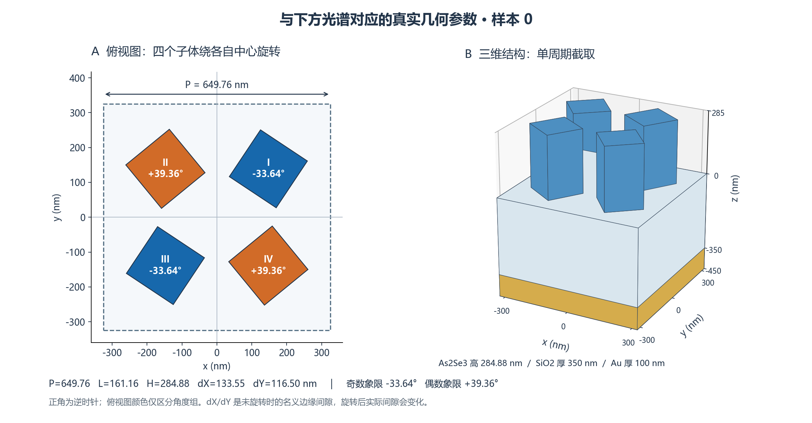
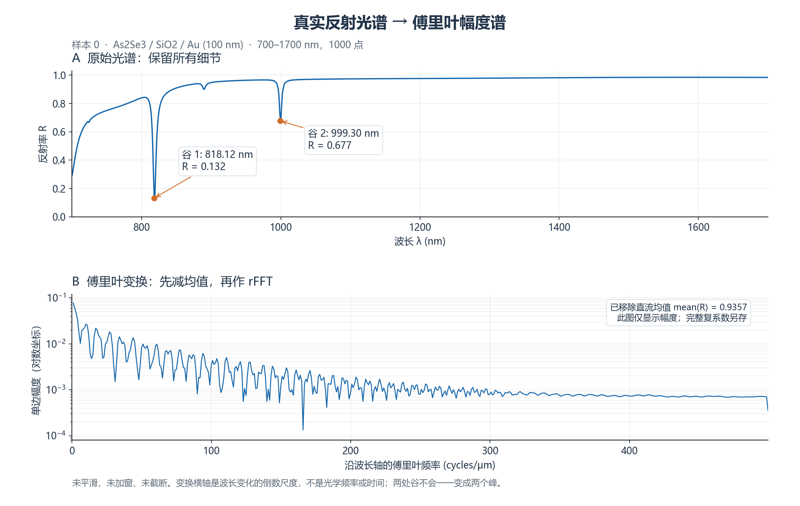

# 真实光谱的傅里叶变换示例

2026-10-18。使用已完成的 100 个样本中的 sample_id=0，不启动新仿真，也不改变训练输入。



结构图根据数据记录的参数重绘，俯视图使用项目实际的 `Geometry.vertices()`；三维图截取一个周期，尺寸比例按参数绘制。它不是求解器截图。四个方柱均为 As2Se3，俯视图颜色仅区分奇、偶象限的旋转角。

| 参数 | 数值 |
| --- | ---: |
| P / 周期 | 649.7604 nm |
| L / 子体边长 | 161.1566 nm |
| H / 子体高度 | 284.8838 nm |
| dX / 未旋转时 x 向名义边缘间隙 | 133.5467 nm |
| dY / 未旋转时 y 向名义边缘间隙 | 116.4992 nm |
| I、III 象限角度 | −33.6448° |
| II、IV 象限角度 | +39.3634° |
| SiO2 基板厚度 | 350 nm |
| 基板底部 Au 厚度 | 100 nm |

每个子体绕自身中心旋转，正角为逆时针。中心位置为 `(±(L+dX)/2, ±(L+dY)/2)`。dX、dY 不是中心距；旋转后也不等于实际最小间隙。层叠的 z 范围：Au 为 −450 至 −350 nm，SiO2 为 −350 至 0 nm，As2Se3 为 0 至 284.8838 nm。层厚来自同目录的原始 `job.json`；打包 NPZ 的嵌入配置没有显式保留 Au 厚度，因此未使用历史类默认值补齐。



这是实际反射率 R(λ)，保留背景、弱小特征和两个主要谷，并未替换成理想双谷曲线。两处主要谷按 prominence > 0.1 检出：

| 特征 | 谷位置 | 谷底反射率 | 半显著度宽度 |
| --- | ---: | ---: | ---: |
| 谷 1 | 818.1181 nm | 0.132325 | 5.2558 nm |
| 谷 2 | 999.2993 nm | 0.677252 | 3.9683 nm |

这里的宽度来自 SciPy `peak_widths(..., rel_height=0.5)`，以各谷的 prominence 为基准，**不是拟合后的标准 FWHM**。原谱采样间隔约 1.001 nm，这些宽度只是离散数据的插值估计。

## 变换方法

波长均匀采样 1000 点，范围 700–1700 nm。先减去均值 0.9357060763，再计算实输入 FFT：

```python
x_um = wavelength_nm / 1000
mean_r = reflectance.mean()
coefficients = scipy.fft.rfft(reflectance - mean_r)
frequency = scipy.fft.rfftfreq(len(x_um), d=np.diff(x_um).mean())
recovered = scipy.fft.irfft(coefficients, n=len(x_um)) + mean_r
```

图中只展示单边幅度，取 `2*abs(coefficients)/N`；直流和偶数 N 的 Nyquist 分量不乘 2。纵轴为对数坐标。没有平滑、加窗、截断、补零或插值重采样。

横轴单位是 **cycles/μm，针对波长坐标的倒数尺度**，不是光学频率 THz，也不是时域脉冲。对反射率强度作 FFT 不能恢复光学电场的时间波形。官方定义见 [SciPy rfftfreq](https://docs.scipy.org/doc/scipy/reference/generated/scipy.fft.rfftfreq.html) 和 [FFT 教程](https://docs.scipy.org/doc/scipy/tutorial/fft.html)。

完整复系数及均值保存在 `sample0_full_fft.npz`，逆变换最大绝对误差为 **2.220446049250313e-16**。此精度说明数值变换可逆，不代表原始 FDTD 结果达到同样物理精度。

## 对预处理的含义

- 两个谷不会一一变成两个傅里叶峰。它们的位置、宽度、深度共同影响整组系数。
- 缓慢背景倾向于贡献低频，窄小变化需要较高频率表示。但这条谱两端反射率相差 0.6918353；DFT 的周期延拓还会产生边界泄漏，所以高频不能全部归因于共振线宽。
- 只保留幅度会丢失相位信息，无法一般性地保留谷的绝对位置。若用 FFT 作为模型输入，优先保留实部/虚部两通道及均值，之后再验证是否值得压缩。
- 如任务确实只关心两个谷，可比较三个输入方案：原谱、FFT 实部/虚部、两个谷各自的中心/深度/线宽（至少 6 个参数，必要时加背景参数）。这是待验证方案，当前示例尚不能说明哪种方案训练更好。
- 压缩方案应检查逆变换后谷位置、深度和宽度的误差，不能只比较全谱平均误差。窄谷在平均误差里容易被大量平坦波段掩盖。

数据仍为原有 `pipeline_validation` 级别，材料拟合精度及网格精度状态未因 FFT 改变。本示例不据此作新物理结论。

## 复现与来源

在独立 Git 工作树运行，不改动原有项目：

```powershell
python .\fourier_spectrum_demo.py --dataset 'D:\仿真\au100_metal8_100\dataset.npz'
```

完整来源哈希、几何顶点和数值检查见 `analysis.json`。原 NPZ SHA256：`591ca0f4d9f4fc0be9803f3a566f72eee1ee3ac871ad9d03472b93a732aed0e3`。
